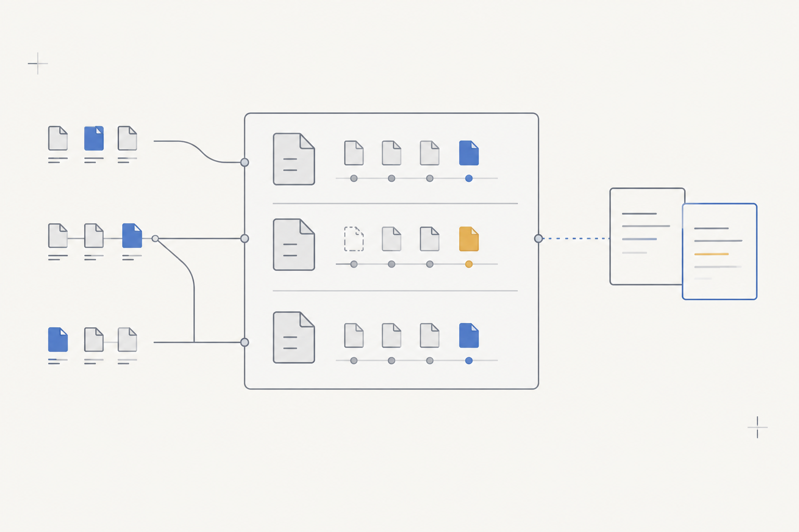
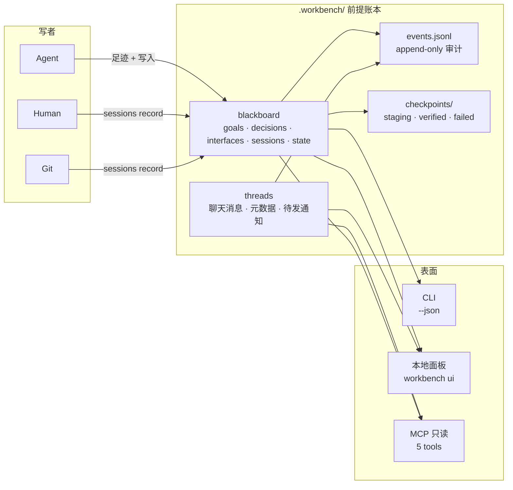
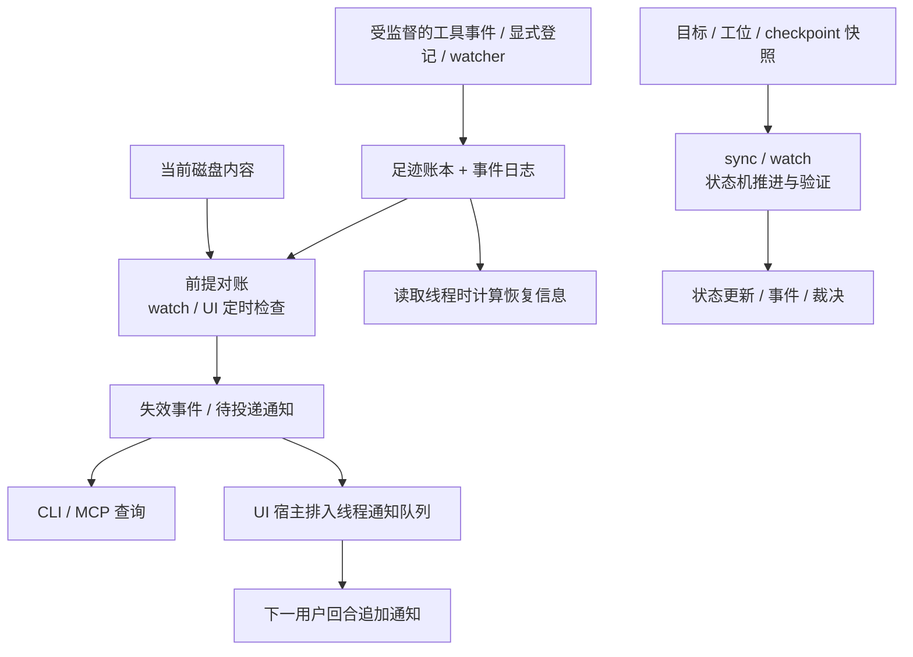
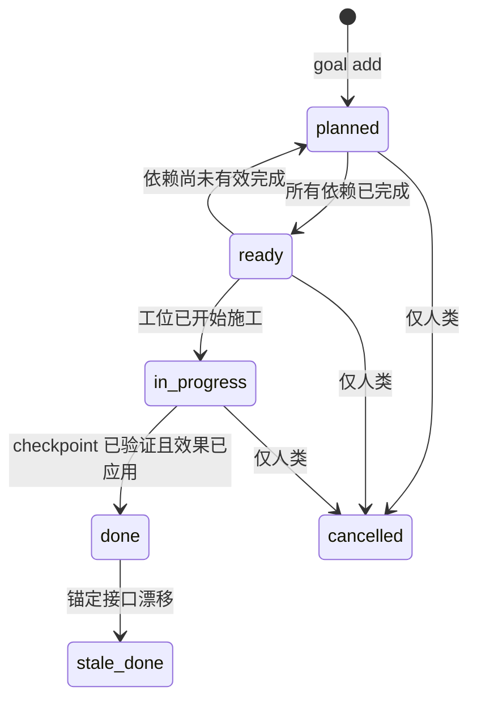
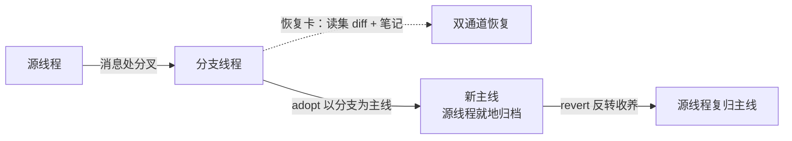

# VerseSpace / Workbench

<p align="center">
  
</p>

<p align="center">
  <a href="https://github.com/Baixu22/VerseSpace/releases"></a>
  <a href="LICENSE"></a>
  <a href="package.json"></a>
  
  
</p>

**Workbench 是本地优先、写者中立的前提账本。** 它记录已捕获或显式登记的 agent、人和 Git 文件足迹，在已记录的前提失效时给出证据，帮助你恢复对话、检查分支和决定下一步。

核心状态保存在项目内的 `.workbench/`（YAML + JSONL），不依赖数据库或指定编辑器。CLI 与本地面板读取项目账本；Agent 可以通过 MCP 查询记录、在后续对话回合接收通知，人通过恢复卡查看变化，需要人工判断的事项进入裁决队列。浏览器草稿与各 CLI 的内部会话数据另有存储位置，见[配置与本地数据](#配置与本地数据)。

---

## 目录

- [现状与验证边界](#现状与验证边界2026-10-26-更新)
- [它能做什么](#它能做什么)
- [它不保证什么](#它不保证什么)
- [核心概念](#核心概念)
- [数据流](#数据流)
- [声明验证范围与单产物重验](#声明验证范围与单产物重验)
- [足迹、前提检测与封印](#足迹前提检测与封印)
- [快速开始](#快速开始)
- [命令速查](#命令速查)
- [本地面板与聊天](#本地面板与聊天)
- [MCP 只读通道](#mcp-只读通道)
- [与 Agent 协作](#与-agent-协作)
- [配置与本地数据](#配置与本地数据)
- [已知限制与实现缺口](#已知限制与实现缺口)
- [仓库结构](#仓库结构)
- [本地开发与门禁](#本地开发与门禁)
- [发行](#发行)
- [存量与历史](#存量与历史)
- [文档地图](#文档地图)
- [许可与归属](#许可与归属)

---

## 现状与验证边界（2026-10-26 更新）

本仓库按**工程研究原型**收尾，不是已验收的产品。两类结论必须分开读：**工程门读数（本机可执行范围）** ／ **产品证据不足**（[ADR-0023](docs/decisions/0023-research-prototype-closeout.md)）。

| 维度 | 现状 |
| --- | --- |
| 工程门 | 当前 `0.5.0` 候选源码包含 Workbench 1242、UI 75、context-rot 69 与真实 Windows 浏览器 15 项验收；静态、两形态构建、声明、归属与默认分支落地读数记录在最终交接，未发布新 Release |
| 声明与读数 | [`evidence/claims.json`](evidence/claims.json) 登记当前命题及历史观测，读数在 `evidence/readings/`；`bun run check:claims` 核对注册范围内的仪器、输入与读数。有效不代表整个产品已验收，历史观测不充当当前通过证据 |
| 产品证据 | **不足**：真人自然使用与非 Windows 实机验证已永久关闭（[ADR-0024](docs/decisions/0024-retire-external-validation.md)），不再作为待办；相关收益与跨平台执行仍未验证。Codex 仅显式原生工具 profile 的 fresh/stale 封印对照已验，不是全通道保护保证 |
| 发行 | 当前公开 Release 仍是 Workbench `0.4.1`；源码候选为未发布的 `0.5.0`，没有 `workbench-v0.5.0` tag 或 Release。**仓库目前为私有，访问源码和 Release 需要仓库权限**；发布不等于公开可下载 |
| 平台覆盖 | 只有 **windows-x64** 跑过完整测试套件；其余三个平台目前只有交叉编译产物 |
| CI | **没有 CI**（[ADR-0021](docs/decisions/0021-retire-all-ci-channels.md)）：GitHub Actions 与极狐 JihuLab 通道都已退役，PR 上不会出现任何状态检查，门禁一律本机手跑 |

> **读表须知**：工程门的绿灯只覆盖「本机能跑的仪器」；产品维度（生产率、真实用户、跨平台）没有被证明，也不要在引用本仓库时把它们说成已证明。

本 README 对应当前主线源码。[2026-09-30 调用链复核](docs/handoff/2026-09-30-readme-callchain-review.md)是修复前的历史记录；[实现记录](docs/handoff/2026-10-01-all-issues-implementation.md)和[接力验收记录](docs/handoff/2026-10-01-issue-relay-closeout.md)说明 #31、#45–#57 的最终落地结果。后续 #70–#77 的产物证据、受控对照与恢复卡交接见 [最终候选收口](docs/handoff/2026-10-26-workbench-0.5.0-candidate.md)。源码候选 `0.5.0` 尚未发布；`0.4.1` 发行物不自动包含这些改动。

### 最近落地的修复与能力

| 范围 | 当前行为 |
| --- | --- |
| #45–#48：通知、封印、大文件、规划提示 | Codex 成功终态才确认送达；封印按本写者当前前提判断；大文件大小变化可检测；规划开关常驻提示新 CLI 进程才生效 |
| #50：验证范围 | 可声明 Vitest JSON 用例集合与配置/检查脚本/锁文件；退出成功但报告缺失、损坏、未更新、零用例、子集或跳过，均不能满足声明范围 |
| #51–#52：产物与交接 | 显式绑定单产物、输入版本、工位和目标 ref；输入变化产生独立重验事项，复读不能清除；原工位通过不等于适用于已推进的 main |
| #53–#54：证据强度与指标 | 区分内容 hash、size-only、unknown；分别统计重读、新版本观察、产物修改和范围验证。重复写同一版本不计为本次修改 |
| #55–#56：成本与模型实测 | 已测合成 JSONL 的 1千/1万/5万条规模，仅去掉恢复查询的一次重复读取；GLM 默认 120 秒请求预算的完整 live 场景通过，历史失败保留 |
| #31：原生 Codex 审批 | Codex 0.159.0 + 本地 GLM + 显式原生工具 profile 的 fresh/stale 对照通过；补留协议夹具和严格成对仪器，仍不保证所有工具路径受保护 |
| #70–#73：产物事实 | 显式历史输入、固定副本、目标范围、便携清单、接收方复核与 CLI/MCP/恢复同一有限投影；未知、来源弱、目标和范围外推进分别保留 |
| #74–#76：受控裁决 | 冻结强朴素/旧主线/增强与消融重放；增强声明范围零错误，旧主线差异保留，四次消费检查 4→1；三尺度总体时间均未优于朴素，不宣称净收益 |
| #77：现有恢复卡 | 显示五状态、来源、输入、检查、目标与复制重验命令；真实浏览器 current/stale/unknown 截图通过，查看/复制不清除待重验 |

这些结果的受测提交、命令、计数和限制见上面的两份记录；性能样本不是容量保证，模型成功样本不是通用可靠性保证。

---

## 它能做什么

- **前提账本**：记录可观测 agent 工具的读写足迹，以及通过 `sessions record` 或 watcher 捕获的人 / Git 文件变化；前提失效时给出可追溯的证据与恢复信息（读集 diff、恢复笔记、分支动静）。
- **三种界面**：
  - **CLI** — 提供全局 `--json` / `--quiet`；长驻服务及 hook 使用各自的协议与退出码；
  - **本地面板** — `workbench ui` 启动聊天面板（线程、分叉、恢复卡、证据与裁决）；目标 DAG、工位与 checkpoint 通过 CLI 管理；
  - **MCP 只读投影** — `premises` / `footprints` / `resume_cards` / `tribunal` / `notices` 五个工具。
- **编排原语**：目标 DAG、工位（git worktree）、三区 checkpoint、派发与 watch 循环、裁决队列。
- **声明范围与产物重验**：将一份产物绑定到明确输入及检查集合，区分历史通过、当前有效性与目标主线适用性；通过 CLI 发起独立重验，或导出有限 manifest 由接收方按本机策略复核。CLI JSON、MCP 恢复卡和聊天恢复卡读取同一有限产物投影；查看与复制命令不写有效性事实。
- **封印（seal）拦截点**：检查只读区域与已有失效前提并留痕。`seal.mode`（`block` 默认 / `warn` / `off`）控制失效前提的处理；只读区域拒写不受该模式及连续命中降级影响。Claude Code 需安装 PreToolUse hook；Codex 是实验通道，覆盖范围与证据返回方式均不同，见下文。
- **聊天面板**：线性对话、消息处分叉、双通道恢复卡、以分支为主线（adopt / revert）、工具足迹可点击查看原始消息与事件；恢复卡可复制既有 checkpoint 重验命令。

一个典型场景：Agent 读取接口文件后，人或另一个任务改变了接口；原 Agent 接下来编辑调用方，即使两边改的是不同文件、Git 没有文本冲突，也可能沿用旧约定。Workbench 可以针对**已记录且可比较的读取**提示文件变化，但不证明模型计划已经失效或已经修好，也不自动把跨文件依赖传播成写禁令。

| 入口 | 当前可以操作什么 | 分工 |
| --- | --- | --- |
| CLI | 目标、工位、派发、checkpoint、接口、决策、体检、足迹、上下文、裁决与统计 | 编排主入口；`dispatch` 和 `agent run` 是两步 |
| 本地面板 | 聊天、取消/重试、分叉、命名/归档/删除、恢复卡、证据、聊天配置、裁决 resolve/shelve | 聊天表面；没有目标 DAG/工位管理页面；单个页面一次只允许一个发送中的回合 |
| MCP | 前提、足迹、恢复卡、裁决、通知查询 | 只读查询；不会派发、执行工具、后台扫描或主动推送 |
| HTTP API | 面板使用的聊天/配置/裁决接口，另有 state/sync/dispatch/agent/run/review 等路由 | 部分路由供脚本与调试使用；存在 API 不等于 SPA 有按钮 |

---

## 它不保证什么

- **足迹覆盖有限，沉默不等于前提全部有效。** 只识别部分工具与路径形状；Shell 后备解析有限，不会任意解析所有读取命令。大文件、目录、过期活跃窗口等也影响覆盖，见下文。
- **封印不是仓库级写保护。** Git 与裸编辑器绕过拦截点；对某个命令的负面观测不能泛化到整个 CLI 版本；Codex 通道可能不发审批、目标可能无法归因，封印故障时当前实现放行。
- **block 也有降级规则。** 对失效前提，同一写者默认连续命中三次后，后续连续命中降为 `warn` 并放行，由 `seal.consecutiveBlockLimit` 控制；只读区域拒写不参与降级。
- **不宣称效率收益。** 原型结题不等于已证实生产率提升。
- **不宣称跨平台已验证。** 四平台二进制由一台 Windows 主机交叉编译；只有 windows-x64 跑过完整测试。
- **不宣称 npm 包已可用。** 对外承诺的形态是 Release 上的单文件二进制；`@baixu22/workbench` 尚未发布到公开 registry。
- **不提供全局事务、自动语义合并或可串行化保证。** 工位可以隔离工作目录，但聊天线程本身不创建 worktree；运行锁也不锁住编辑器、Git 或所有工具副作用。

---

## 核心概念

| 概念 | 是什么 |
| --- | --- |
| **前提（premise）** | 已记录的读取路径及采集到的版本；对账按版本、读取范围及适用的导出表面规则判断变化。它不是完整的程序依赖图，也不是对模型理解或计划正确性的证明 |
| **足迹（footprint）** | 从工具事件或显式登记得到的读写路径、版本等记录；覆盖取决于采集通道 |
| **写者（writer）** | agent、人、git——共享写者模型；只有被捕获或登记的操作才进入账本 |
| **工位（workspot）** | 绑定 git worktree 的工作位；派发时生成 `.agent-context.md` |
| **checkpoint** | 阶段验收点，三区：`staging` / `verified` / `failed`；可声明验证策略 |
| **裁决（tribunal）** | 系统答不了、需要人类决策的事项队列 |
| **封印（seal）** | 写入前的拦截判定点，两类互不折叠的原因：`readonly_area`（`protection.readonlyAreas` 声明的只读区域，先判、恒拒）与 `stale_premise`（读过的前提已被改动） |
| **恢复卡（resume card）** | 线程离开期间发生了什么：读集 diff、恢复笔记、分支动静 |



---

## 数据流



### 编排与文件前提使用不同入口

| 触发入口 | 实际调用链 | 不会顺带做什么 |
| --- | --- | --- |
| `sync` / `POST /api/sync` | `runOnce` → 运行锁 → 派发恢复 → 快照/evaluator → 应用转移及验证 → 接口重锚定 → 调度 → 空闲提醒/到期裁决 | 不调用 `reconcilePremises`，不启动聊天或批处理 Agent |
| `watch` | 启动时一轮；之后文件事件合并（默认 500ms）→ 捕获部分人/Git 足迹 → `runOnce` → `reconcilePremises` | CLI watcher 不持有聊天会话，不消费通知；`runOnce` busy 时该次跳过后续对账 |
| `ui` 后台周期 | 默认每 15 秒 `runReconcileTick` → `reconcilePremises` → `drainPremiseQueue` → `notifySession` 排队 | 不启动完整 watcher，不自动跑 `runOnce`；不实时打断当前模型回合 |
| 聊天发送 | `POST …/messages` → 线程队列 → 读取待发通知 → 追加到当前提示 → provider runner → 消息/足迹/确认 | 发送本身不先全量重扫读集，可能尚未拿到下一次周期才发现的变化 |
| 读取线程/恢复卡 | `collectRestoreView` → 离开时的读集基线与当前磁盘比较 → 事实/笔记/分支投影 | 不是推进目标状态机，也不把读卡动作当作模型已修复 |
| `premises pending` / MCP `premises` | 折叠已有失效与投递记录 | 不触发新的前提检测或投递 |

`runOnce` 只在**入口快照**上求一次转移；本轮产生的效果由下一轮拾取，不在同一轮递归推进。接口重锚定后的下一轮才会使相应已完成目标变为 `stale_done`。运行锁（O_EXCL pid 锁）使多个 `runOnce` 互斥，冲突返回 `busy`；它不是整个项目的文件写锁。

实现入口：[runtime/index.ts](packages/workbench/src/runtime/index.ts)、[watcher/index.ts](packages/workbench/src/watcher/index.ts)、[ui/reconcile-loop.ts](packages/workbench/src/ui/reconcile-loop.ts)、[chat/thread-run.ts](packages/workbench/src/chat/thread-run.ts)。

### 目标完成与 checkpoint



依赖只有 `done` 才算满足；`stale_done` / `cancelled` 阻塞下游。目标完成要求相应 checkpoint 在 `verified/` 且效果已 `applied`，同时依赖仍全部有效完成。`cancelled` 与 `stale_done` 不会自动恢复。实际转移见 [goal-machine.ts](packages/workbench/src/automaton/goal-machine.ts)。

checkpoint 的**目录**（staging / verified / failed）、**生命周期**（draft / pending / verified / applied / failed / awaiting_review / rejected）和**验证结果**是不同字段。`verified` 表示验证过关，`applied` 表示声明的账本效果已经应用；两者都不表示代码已经提交、合并或发布。

## 声明验证范围与单产物重验

自动检查可以通过 `--evidence <声明文件>` 指定 Vitest JSON 报告路径、完整的 `fullName` 用例集合，以及必要的非敏感配置、检查脚本和锁文件。验证同时记录实际用例名称/状态、数量与报告 hash。只有报告确由本次更新、实际集合与声明一致且全部通过，才满足范围；报告缺失、损坏、计数矛盾、零用例、只跑子集或含跳过均不能冒充完整验收。未声明报告的旧用法仍保留退出码结果，但范围未知。

在原有 checkpoint 参数上增加 `--artifact <产物路径>`、`--input <输入路径...>` 和可选 `--target-ref <ref>`，即可声明一个产物的依赖。例：读 `api.ts@v1` 后形成 `consumer.ts`，API 变为 v2 时，产物进入待重验；只重读 API 不证明 consumer 已兼容。检查失败继续保留事项，修复后通过或无需改代码而通过，都会产生新的验证证据。

```bash
# 在已准备好工位与声明文件的项目中，ID 替换为实际值：
workbench checkpoint create --goal <goal-id> --workspot ws-a --assertion "consumer 兼容 API" --strategy test --command "bunx vitest run --reporter=json --outputFile=report.json" --evidence checks.json --artifact src/consumer.ts --input src/api.ts --target-ref main
workbench checkpoint list --json
workbench checkpoint revalidate <checkpoint-id> --workspot ws-a --target-ref main --json
```

声明文件格式与准备步骤见[包说明](packages/workbench/README.md#声明验证范围与单产物重验)。路径相对执行工位；检查脚本、配置与锁文件应显式列入 evidence inputs。依赖来自调用者声明，不把“先读 A 后写 B”推断为强因果，也不自动寻找全部传递依赖。

`checkpoint list --json` 的 `currentArtifact` 将 `current / stale / pending / failed / unknown` 与 `targetStatus` 分开呈现。记录保留原始仓库/工位来源、本次执行目录和目标 ref/tree；dirty/untracked 的声明文件内容参与比较，同内容暂存或提交不单独算作产物语义变化。原工位磁盘不变而目标 main 推进时，不能沿用旧目标结论；`inputs-match` 也只表示声明输入匹配，**不证明合并结果已验证**。

重验生成新的 checkpoint，不撤销历史 `applied/done`、不重复执行旧账本 effects。运行锁防止并发重验，不锁住外部编辑器或服务；缺失身份、文件或执行证据时保留未知。设计与验收范围见 [ADR-0025](docs/decisions/0025-declared-verification-and-artifact-revalidation.md)。

---

## 足迹、前提检测与封印

### 记录从哪里来

| 来源 | 记录方式 | 覆盖边界 |
| --- | --- | --- |
| Workbench 监督的 Claude 聊天与默认批处理 | `tool_use` 识别路径，成功 `tool_result` 后登记，关联工具 id 与事件 | 失败或无结果的尝试不会当作成功读写；不是任意工具都能提取路径 |
| 实验性 Codex 聊天 | `commandExecution` 的结构化 `commandActions[].path`，无可用结构化路径时有限解析 `cat` | 原生 `fileChange` 的审批路径关联与足迹提取是两条链；能关联审批不代表相应写足迹已完整记录 |
| `sessions record` | 显式 `--used` / `--generated`，或 stdin 逐行路径作为写入；默认写者为 git | 只记录调用者提交的路径和登记时磁盘版本，不自动观察人的读取 |
| `watch` | 项目文件变化批量归给 human；已被近期 agent/git 足迹声明的路径尽量去重；监听部分 Git refs/HEAD | 归因是尽力而为，不是操作系统级进程审计；ref 变化本身不是完整 Git 文件 diff，worktree 的 `.git` 文件/自定义 gitdir 也不能假定都被覆盖 |
| context-rot PostToolUse hook | 写 `.context-rot/footprints.jsonl` | **这是独立日志，不会自动导入 Workbench 的 sessions 读集**；只安装 hook 不等于建立完整前提链 |

`sessions record` 的简单用法（路径相对被管理项目）：

```bash
workbench sessions record --writer human-review --kind human --used src/api.ts
workbench sessions record --writer git --kind git --generated src/api.ts
workbench --json sessions show --writer human-review
workbench --json premises pending
```

最后一条只查询已有通知；需要运行 `watch` 或 `ui` 的周期检测后才可能出现新的失效记录。

### 对账如何判断变化

[footprint.ts](packages/workbench/src/blackboard/footprint.ts) 从磁盘采集版本与可选快照，[session-view.ts](packages/workbench/src/blackboard/session-view.ts) 保留每条路径的多段、多版本观察；完整重读或相同范围的重读替换对应旧观察，局部重读不会清空其他范围。已测得版本的自身写入仍按原契约更新该路径的观察基线。它不是模型推理依赖的完整集合，也不是与外部工具读取原子绑定的字节快照。

[reconcilePremises](packages/workbench/src/runtime/premises.ts) 默认只检查最近 **30 分钟**活跃的 agent/human 写者：

1. 跳过按路径规则归为 `durable` 的依赖/生成物（如 `node_modules/`、`vendor/`、`dist/`、`.git/` 等）；这是过滤策略，不代表这些内容实际上永远不会改变。
2. 文件版本不变则跳过；有读取范围时，结合 diff 和范围 hash 判断变化是否触及已读片段。
3. 无范围且没有被该写者修改过的 JS/TS 类依赖，可按导出表面启发式过滤正文变化；显式全文读取仍检查正文。签名不变不等于行为不变，这不是语义等价证明。
4. 对留下的变化记录旧/新版本与可用 diff，按写者、路径、当前版本去重。

资源上限会直接影响覆盖：**大于 2,000,000 字节的文件只记大小，不计算内容 hash；前提对账与恢复检查都用大小比较变化，同尺寸改写仍无法检测**。采集记录的 `version` 仍为 null，比较时通过 [claim-version.ts](packages/workbench/src/blackboard/claim-version.ts) 将已有大小投影为 `size:N`，通知身份和去重也使用该版本，避免连续不同大小的变化被合并。既无 hash 又无大小的记录不能视为可比较，恢复检查仍记为 unsupported。

只有至多 64,000 字节的 volatile 文件会保存读取快照，每写者保留最近 20 份；淘汰或缺失快照会使 diff 不可用、部分判断退回保守提示。目录、读取失败和未识别工具也不能当作已验证。

`sessions show --writer <id> --json` 的 `readFragments[].strength` 及恢复卡明确区分 `content-hash / size-only / unknown`。跨版本读取片段仍按版本和坐标处理，不保证符号移动追踪；快照淘汰不删除旧前提，也不将不可比较的内容标成未变。

### 通知怎样进入模型

失效事件先保存在审计日志，UI 宿主再排入 `threads/<id>/notices.jsonl`。下一用户回合读取队列，把通知追加进提示，并作为该用户消息的 `notice` part 保存。批处理写者没有该聊天通道，其通知保持 pending；MCP 读取通知也不会替它确认。

`chat.noticeTokenBudget` 默认近似 300 token，按字符估算，优先保留路径/版本事实，再裁剪 diff，并说明未展开数量；不是精确 tokenizer 配额。通知确认因通道而异：Claude 看成功 result 帧，HTTP 看完整且无错误的终止流；**Codex 仅在收到 `turn/completed` 且状态为 `completed`、回合无错误时确认**。provider 错误、失败或中断回合保留待发通知，后续成功回合才确认送达。重试/记账失败仍可能带来重复投递，未提供端到端 exactly-once 保证。

“通知排队”“记录为已投递”“出现复读足迹”“程序验证通过”是不同证据。任何一个单独成立都不能证明计划或代码已经修复。实现见 [notice-queue.ts](packages/workbench/src/chat/notice-queue.ts)、[thread-run.ts](packages/workbench/src/chat/thread-run.ts)。

### seal 实际拦截什么

[seal](packages/workbench/src/runtime/seal.ts) 判断写目标是否与已有失效路径重叠，或位于 `protection.readonlyAreas`。生产入口每次按写者的当前读集重新检查，独立于周期通知检测与是否送达；这仍不是原子读取或全局写锁。失效依赖在 `api.ts`、写目标在 `handler.ts` 时，不会仅凭这条依赖自动拒写。

- Claude 通过 `PreToolUse` hook 接入；安装器匹配 `Write|Edit|MultiEdit|NotebookEdit`，未匹配的 Shell/Git 等路径不由该 hook 拦截。
- Codex 只在可归因的写审批上咨询 seal；原生写审批需要用 `itemId` 关联先前的 `fileChange` 路径。无审批、路径未知或 seal 错误时不能称为受保护。
- 对失效前提，`block` 默认拒绝；同写者连续命中达到默认 3 次后，后续命中降为 warn。`warn` / `off` 放行但保留观测；只读区域拒写不随这些设置降级。
- 判定会记录 `seal.decided`。Claude hook 命中时通过 stderr 返回原因；Codex 审批适配器目前只把阻断结果转换为 accept/cancel，并没有同样回传完整原因文本。不能把共同调用判定函数说成两条车道具有相同的反馈闭环。
- `premises review-seal` 记录人工对判定的复核，不会自动修复文件、重规划或覆盖工具权限。

Codex seal 与带 `--writer` 的 Claude hook 按当前写者的读集和磁盘重新判断前提，不再以 pending 通知作有效性来源。通知送达不解除仍失效的前提，当前版本的重读也不再被未确认的旧通知误阻断。`premises current --writer <id> --json` 查询当前失效输入，`premises pending` 仍只查询待投递通知；两者都不证明派生产物已经修复。该修复不扩大审批或足迹覆盖范围，Codex 的显式原生工具 profile 已通过 fresh/stale 对照（[#31](https://github.com/Baixu22/VerseSpace/issues/31)），未归因和无审批路径仍不保证受保护。

直接实测使用 Codex 0.159.0、本地 GLM、显式原生 apply_patch 工具目录、on-request 审批及 read-only Windows elevated sandbox：fresh 记录一次 pass 并落下一条写足迹；stale 记录一次 block，文件未变且无写足迹，两者均没有写回合复读。可复跑入口是 `bun packages/workbench/scripts/verify/codex-native-pair.ts`，需要隔离的 CODEX_HOME 与匹配的本地配置。模型自行拒写、补丁上下文失配或仅 CLI 沙箱拒写都不能充当 Workbench 封印通过；实验配置和非通过样本见[接力验收记录](docs/handoff/2026-10-01-issue-relay-closeout.md)。

---

## 快速开始

具有仓库访问权限的用户可从 [VerseSpace Releases](https://github.com/Baixu22/VerseSpace/releases) 下载对应平台的 `workbench-*` 单文件可执行程序，放入 PATH 并命名为 `workbench`（Windows 为 `workbench.exe`）。二进制内含运行时与面板，启动 Workbench 本身无需另装 Bun；项目验证命令需要的 Bun/Node/编译器等仍需单独准备。

下载时同时获取 `SHA256SUMS`，用 PowerShell `Get-FileHash .\workbench-windows-x64.exe -Algorithm SHA256` 比对对应条目。非 Windows 产物仅交叉编译，未做实机验证。

二进制自带 Bun 运行时，但创建工位、分支与派发需要本机 Git 和已有提交的 Git 仓库。`claude` / `codex` 聊天还需要分别安装并完成相应 CLI 的认证；HTTP 通道需要配置对应服务的端点、模型和密钥。本地优先指账本存储在本机，模型请求仍会发往配置的服务。

在要管理的项目目录中运行：

```bash
workbench init
workbench ui
```

`workbench ui` 启动本地面板，默认地址为 `http://127.0.0.1:7700`（`--port` 可换端口，`--no-open` 只起服务）。`workbench --json doctor` 检查账本一致性；它先跑指令文件的 context-rot 扫描（有 `.workbench/` 时再做账本体检），**指令文件出现失效引用，或账本体检出现 `severity: "error"` 的问题，任一都让它非零退出**（`dangling_subscriber`、`half_adopted` 等 warning 级问题不改变退出码）。

**编排示例（命令模板）：**

在已有提交的 Git 仓库中操作，并先准备好项目的验证命令。下面的 `<goal-id>` 要替换为 `goal add` 返回的 ID；完整 PowerShell 示例及验证策略见[包说明](packages/workbench/README.md#编排操作示例)。`init` 不安装 Git、agent CLI 或 hooks，也不会修改项目的 `.gitignore`。

```bash
workbench goal add "实现并验证本次改动" --acceptance "相关测试通过"
workbench sync                  # 无阻塞依赖的目标从 planned 变为 ready
workbench ws create ws-a --task <goal-id> --branch ws-a
workbench dispatch <goal-id> ws-a
# 在返回的 worktree 内完成开发、安装依赖和验证，再回到项目根目录：
workbench checkpoint create --goal <goal-id> --workspot ws-a --assertion "相关测试通过" --strategy test --command "bun test"
workbench sync                  # 执行验证；检查输出的 passed / failed 等结果
workbench checkpoint list
workbench watch                 # 可选：前台持续监听，Ctrl+C 停止
```

`ws create` 只登记工位；`dispatch` 才创建 / 绑定 worktree 并生成上下文，不会自动启动 Agent。需要批处理时，另运行 `workbench agent run --workspot ws-a`；也可自行在工位里开发。`agent run` 返回启动结果，进程结束状态写入 `.workbench/agents/ws-a/latest.json`；启动成功不等于目标完成。

| 验证策略 | 默认行为 | 结果 |
| --- | --- | --- |
| `test` | 在工位目录执行 `bun test` | 按子进程退出码判断 passed / failed，超时单列 |
| `type-check` | `bunx tsc --noEmit` | 同上 |
| `build` | `bun run build` | 同上 |
| `human-review` | 不运行命令 | needs_human → awaiting_review，需 `checkpoint review <id> --approve` 或 `--reject` |
| 未声明策略 | 不运行命令 | skipped，留在 staging；不当作通过 |

前三种可用 `--command` 覆盖；命令由 supervisor 解析成 argv 执行，不隐式提供任意 Shell 管道/重定向，复杂验证应放进项目脚本。`--timeout` 的单位为秒；未指定时取 `thresholds.checkpointTimeout`（默认 `5m`）。验收文字和 `--assertion` 不会自动转换成测试；未提供 `--evidence` 时只保留退出码语义，提供声明后还会校验实际用例集合与计数，见[声明验证范围与单产物重验](#声明验证范围与单产物重验)。

验证通过后，继续 `sync` 才推进应用效果与目标完成。无额外阻塞的本轮隔离示例实测为：第一轮 verified，第二轮 applied，第三轮 goal done；有其他状态变化时不能把三轮当通用保证。**`sync` 退出 0 也可能包含失败的验证结果**，验收要检查 `verifications[].result.status` 与 checkpoint 记录。

**验证有保质期（2026-09-30 起）**：新验证绑定检查前后一致的 Git 可见代码状态（HEAD、改动文件 hash 与删除状态），以及实际执行目录、解析默认值后的检查命令、预期退出码和超时。推进 `applied` 前再次比较，代码或执行条件改变时退回 `staging` 重验；检查期间发生变化或采集失败时保留实际结果，停在 `awaiting_review`。人工批准另记 `authority=human`，不冒充再次运行自动检查。旧记录可兼容读取，但缺少完整绑定时不能宣称当前有效。

`checkpoint list --json` 在原记录旁返回只读的 `currentVerification`；文本列表和恢复卡使用同一判断，区分失败、超时、跳过、待审查、历史通过但当前未知、以及验证已过期。查询不执行检查、不改事件或生命周期。恢复卡的当前失效文件数来自当前读集，历史检测事件另列，重读不等于旧测试重新通过。显式 evidence inputs 可绑定被 Git 忽略的配置、检查脚本和锁文件；记录的是 Workbench 的运行时版本，不保证子进程实际工具链、未声明文件、环境变量或外部服务，也不是原子快照。声明用例通过不证明声明本身覆盖了全部需求。

`checkpoint restore` 也不是全仓快照恢复：`--code` 对快照记录中后来发生变化的路径恢复到采集时的 **Git HEAD 内容**，并非还原当时尚未提交的正文；不在该 HEAD 的新增文件可能恢复失败。`--context` 恢复已保存的接口注册表旧值，不是回滚聊天历史或模型记忆。无对应快照会拒绝；`--both` 不承诺代码与账本的原子事务。默认只显示计划，`--yes` 才执行，**同时使用 `--json` 始终只输出计划**。

完整安装、配置、聊天与 MCP 用法见 [Workbench 使用说明](packages/workbench/README.md)。

---

## 命令速查

| 命令 | 作用 |
| --- | --- |
| `init` | 幂等初始化 `.workbench/` 目录 |
| `goal add/list/show/cancel` | 目标 DAG 管理 |
| `decision add` | 追加架构决策（append-only，修正靠新决策取代） |
| `interface register/list/check` | 接口注册表与 hash 漂移检查 |
| `ws create/list/reassign/status` | 工位（git worktree 绑定）管理 |
| `checkpoint create/list/restore/review/revalidate` | 三区 checkpoint（staging / verified / failed）；`restore` 默认 dry-run，`--yes` 才执行（`--code` / `--context` / `--both` 三选一；`--json` 模式只输出计划恒不执行），`review --approve/--reject` 裁定 human-review checkpoint；`revalidate` 为声明产物生成独立检查证据 |
| `dispatch <goal> [ws]` | 派发就绪目标到空闲工位（真实 git worktree + 上下文生成）；`--force` 可越过满载的 CONWIP 池 |
| `sync` | 手动跑一轮 Runtime 循环 |
| `watch` | 前台常驻监听，文件变化后推进编排并对账前提；Ctrl+C 停止 |
| `status` / `map` / `log` / `queue` | 状态概览 / DAG 文本图 / 事件流 / 执行队列 |
| `doctor` | 指令文件 context-rot 扫描 + 账本体检；失效引用或 `severity: "error"` 才非零退出 |
| `config set <key> <value>` | 修改 `workbench.yaml` |
| `stats` | 分叉、恢复耗时、通知结局、地标认可率与样本不足情况 |
| `metrics` | 已记录的批处理工位用量：tokens / 缓存命中 / 压缩次数；不是全部聊天 provider 的统一计费统计 |
| `wip` | 当前在制、未复核积压与 CONWIP 准入上限；历史不足时显示 insufficient-history |
| `sessions list/show/record` | 写者记录；登记 git 或人的文件改动 |
| `premises pending` / `premises current` / `premises seal` / `premises review-seal` | 待投递通知；当前失效输入；显式封印判定点；复核一次封印 |
| `context list/lower/review --writer <id>` | 查看上下文、降低过时条目兴趣、记录地标认可或拒绝 |
| `agent run` | 在工位内启动 agent 会话 |
| `tribunal list/show/shelve/resolve/stats` | 裁决队列（SBAR 卡片、搁置、结案、验收数） |
| `mcp` | 启动只读 MCP 服务器（stdio） |
| `ui` | 启动本地面板 |

CLI 提供全局 `--json`（机器可读）与 `--quiet`；`ui` / `watch` / `mcp` 等长驻服务仍按各自的服务或协议运行。

---

## 本地面板与聊天

```bash
workbench ui            # 打开 http://127.0.0.1:7700（自动开浏览器）
workbench ui --no-open  # 只启动服务，适合自动验证与无界面环境
workbench ui --port 8080 --ui-dir ./some-dist
```

当前面板以聊天为主：线程、分叉、恢复卡、足迹证据和裁决队列（composer 上方可直接 resolve / shelve）。目标 DAG、工位派发、checkpoint、接口、决策和 doctor 使用 CLI；后端存在相应路由不代表面板已提供管理页面。源码入口若找不到已构建的面板资源，页面返回 HTTP 503。

面板实际入口为 `App → ChatProvider → WorkbenchShell`，请求经 `apiFetch` 取得启动令牌，再进入聊天/配置/裁决路由。模型 HTTP 车道使用 SSE；**后端向面板输出的是按行 JSON（NDJSON）**，前端按 messageId 折叠流事件，并使用 `@assistant-ui/react` 与 Streamdown 渲染。

单个页面的 `runningThreadId` 同时只跟踪一个发送回合；聊天线程按各自队列串行。后台与多个请求的能力不能直接等同于“面板支持多 Agent 同时施工”。本机 Claude/Codex 聊天进程都在**被管理项目根目录**启动；创建聊天分叉不创建工位，也不切换 Git 分支。

### 本地 API 与安全边界

服务只绑定 `127.0.0.1`，校验 URL 主机名；`GET /api/bootstrap` 返回本次启动的令牌，其余 `/api` 请求需要 `x-workbench-token`，缺失或不匹配为 401。SPA 自动握手，服务重启后遇 401 会重新取一次令牌。服务不发送 CORS 许可头；这个令牌不防同机进程，不是多用户认证，也不是 Agent 沙箱。请作为单用户本机服务使用，不把端口公开到网络。

| API 组 | 当前调用方与用途 |
| --- | --- |
| `/api/bootstrap`、`/api/config/chat` | SPA 启动与聊天配置 |
| `/api/chat/threads` 及线程子路由 | 聊天、流式发送、分叉/恢复/重试、归档/删除、证据 |
| `/api/tribunal` 及 resolve/shelve 子路由 | composer 上方裁决条 |
| `/api/chat/feedback` | 消息反馈 |
| `/api/state` | 完整状态与对账错误计数，**SPA 未调用**；供脚本/人查询，也需要 token |
| `/api/sync`、`/api/dispatch`、`/api/agent/run`、`/api/review` | 已有的编排/复核路由，当前聊天面板没有对应管理页面 |

路由清单见 [server.ts](packages/workbench/src/ui/server.ts)、[chat-routes.ts](packages/workbench/src/ui/chat-routes.ts)、[workspace-routes.ts](packages/workbench/src/ui/workspace-routes.ts)。没有文件上传、浏览器终端或通用文件编辑器的 API；不能从聊天中的工具展示推断这些功能已交付。

### 聊天通道的观测与保护边界

| 车道 | provider | 读集（agent 读了哪些文件） | 前提失效时 |
| --- | --- | --- | --- |
| 工具车道 | `claude`（本机 Claude Code） | 部分可观测：识别到路径且有成功结果的工具调用 | 对可比读集给出变化证据；seal 需独立安装 hook |
| 实验工具车道 | `codex` | 部分可观测：结构化路径与有限 cat 后备解析；无路径的 Get-Content 不被捕获 | 可归因写审批会咨询 seal；缺足迹、无审批或无法归因时不受保护。Codex 0.159 的显式原生 profile 曾有正面对照；当前 26.1021 隔离 profile 实测 fresh/stale 原生写均落盘且无 seal 事件，**当前未通过写保护声明** |
| 纯文本车道 | `openai-chat` / `openai-responses` / `anthropic` | 当前实现不执行文件工具，因而没有本轮工具读集 | 可消费已排队通知并重发文本历史，但不能据回复证明读取或修复；已有历史证据不会因此被删除 |

选择建议：需要文件工具足迹时优先使用 `claude`，并核对本节的采集/继承条件；纯对话可使用 HTTP 车道，无需本机 Claude 登录。provider 是全局配置，线程头根据 `lastRun` 展示**最近一轮**的可观测性限制；它不是逐条历史消息的完整 provider 归属记录，也不代表整条线程始终使用同一车道。

Claude 聊天车道在 spawn 时挂上 Workbench 的**只读账本 MCP**（`--mcp-config` + `--allowedTools mcp__workbench`），模型在回合中可自查前提与足迹；折入某一回合的前提通知会作为该用户消息上的 `notice` part 持久化（三类 runner 共用此入口）。默认仅对默认 CLI 命令开启：`WORKBENCH_CLAUDE_MCP=off` 关闭，`=on` 可对自定义 `WORKBENCH_CHAT_COMMAND` 强制接线。此自动接线不覆盖独立 `agent run`，也不安装 seal hook。

Codex 的服务器审批默认答复 accept；仅可归因且 seal 阻断的写审批答复 cancel。用户输入/elicitation 请求自动 decline，当前没有把它转成用户交互问答的通路。它继承本机 Codex 自身的认证和权限配置，不能将 Workbench 的实验性拦截当作权限隔离。

### 分叉、恢复与「以分支为主线」



- **分叉**：复制截至锚点的 UI 消息前缀，源消息不变。**复制界面历史不等于模型继承了上下文。** Claude 仅在锚点是当前尾部、父线程有可恢复 session、且当前没有在用的 Claude 进程时生成 `--resume --fork-session` 计划；中途锚点等情况启动新 provider 会话，不会自动把所见 UI 历史全部回放给 Claude。
- **读集继承**：上述 Claude fork-session 路径还需源足迹非空、存在可比版本；首次运行前继承字段为 null，观察到 provider 的 assistant/result 后才记录结果。Codex 没有对应父上下文 fork，HTTP 则通过请求重发文本历史，二者均不镜像父读集。详见 [thread-fork.ts](packages/workbench/src/chat/thread-fork.ts)、[thread-inheritance.ts](packages/workbench/src/chat/thread-inheritance.ts)。
- **恢复卡**：离开时记下消息/足迹/事件边界；返回时比较磁盘与已读版本，叠加分支事实。恢复笔记由已有消息与工具记录确定性推导，**不会额外调用模型生成总结**；用户可编辑/确认。无可比足迹时显示覆盖不足，而不是假称现状已核实。
- **adopt / revert**：`POST /api/chat/threads/:id/adopt`（`:id` 为被收养分支）清掉该分支的 `forkOf`、源线程就地归档并挂上身份快照；`revert`（`:id` 为源线程）消费快照还原双方 `forkOf`/`archived`。它只翻转线程身份，不是 Git 分支合并或代码回退；双方消息一字不改、不合并（数据模型里没有 mainline 指针，「主线」即「不再作为分支渲染」）。两个动作都落审计事件（`thread.adopted` / `thread.adoption_reverted`）。
- **命名与归档**：支持手动命名、由现有消息规则推导名称、归档/取消归档；归档不删除消息。删除经 UI 确认后移除该线程目录，并不清除全部历史事件或 Git 改动。
- **重试**：reload 删除末条助手消息，再由前端重发对应用户输入；不回退代码或工具副作用。Claude 会重建 provider session，但保留的 UI 消息不等于自动回放的 provider 历史；Codex 当前 reload 未同步重建远端 session，不能称为精确会话回滚。

### 聊天配置

默认 provider 为 `claude`。可在面板配置入口选择通道，或用 `workbench config set chat.provider codex` 等命令修改配置。**`chat.model/baseUrl/apiKey/temperature/maxTokens` 当前只用于 HTTP 请求，不传给本机 Claude/Codex**；本机 CLI 的模型、端点与认证使用其自身设置或自定义启动命令。设置面板显示/保存某个字段，并不意味着每条车道都使用它。

| HTTP provider | 请求协议 | 未显式配置时的代码默认值 |
| --- | --- | --- |
| `openai-chat` | Chat Completions，`/chat/completions` | baseUrl `https://api.openai.com/v1`，model `gpt-4o-mini` |
| `openai-responses` | Responses，`/responses` | 同上；`chat.effort` 仅该请求形状使用 |
| `anthropic` | Messages，`/v1/messages` | baseUrl `https://api.anthropic.com`，model `claude-sonnet-4-5`，maxTokens 1024 |

这些是实现默认值，不承诺当前服务供应商支持、账号有权限或模型参数兼容。HTTP 通道需使用匹配的协议、端点、模型和密钥。`chat.fanout` 为 1–3（未设置等同 1），**仅 HTTP runner**会并发请求备选，主回答与备选共用取消信号；CLI 车道不使用它。开启备选会增加模型调用。

HTTP provider 可从服务进程的 `WORKBENCH_CHAT_API_KEY` 环境变量读取密钥。非空的 `chat.apiKey` 保存值优先，删除保存值不会清除环境变量；环境变量改变后需重启服务。聊天配置与面板状态 API 隐去密钥、返回 `hasKey`，但写入 YAML 的密钥并未加密。将 `.workbench/` 作为本地数据保存，避免上传凭据、对话与读取快照。

同一线程切换 provider 时，不会自动迁移两个 CLI 的内部历史。HTTP 重发的是本地消息文本；Claude/Codex 恢复的是各自保存的 provider session。面板的统一消息外观不保证跨 provider 的内部上下文连续。

---

## MCP 只读通道

`workbench mcp` 在 stdio 上以 MCP 协议暴露**五条只读工具**（JSON-RPC 2.0，未引入 MCP SDK）。工具不暴露编排写动作；工具返回的是文本，默认截断到 ≤2000 字符并标出截断。`initialize` / `tools/list` / `tools/call` 等协议消息按行 JSON 传输，不是 HTTP MCP 服务。

| 工具 | 回答的问题 |
| --- | --- |
| `premises` | 默认查询待投递通知；`view=current` 重新核对当前失效输入，独立于投递状态 |
| `footprints` | 最近已登记的写者读写路径；可按 writer 筛选，不能据空结果断言从未读取 |
| `resume_cards` | 线程在离开期间发生了什么；默认读集/恢复笔记/分支动静，`view=artifacts` 读取同一有限产物投影 |
| `tribunal` | 裁决队列里有什么在等人类决策 |
| `notices` | 通知投递情况（已投递 / 待投递） |

**Claude Code** — 在项目根 `.mcp.json` 添加：

```json
{
  "mcpServers": {
    "workbench": {
      "command": "workbench",
      "args": ["mcp"]
    }
  }
}
```

上述配置要求客户端在目标项目内启动进程；也可显式添加 `"--root", "D:/projects/my-app/.workbench"`，把路径换成目标项目的 **`.workbench` 目录**。源码形态使用 `bun` 和 `src/index.ts` 的绝对路径，避免从其他项目启动时找不到入口。也可在项目目录运行 `claude mcp add workbench -- workbench mcp`；注册作用域请按本机 Claude Code 的 `mcp add --help` 选择。

`--root` 是 `mcp` 的选项，不是所有 CLI 子命令的全局选项。普通命令从当前目录向上寻找最近的 `.workbench/`，不会沿 Git worktree 元数据自动找到另一处账本；自定义工位放在项目树外时，编排命令应回到管理项目执行。MCP 查询不建立调用者的文件读集；只把服务挂到外部 Agent 上，并不等于其文件工具已受 Workbench 监督。

**Cursor** — Settings → MCP → Add global MCP server，或使用项目 `.cursor/mcp.json`（形状同上）。

---

## 与 Agent 协作

派发时 Workbench 在工位 worktree 内生成 `.agent-context.md`（按工位声明的 `contextNeeds` 组装任务、验收条件、相关决策与接口）。需要让 agent 实际阅读该文件；生成文件本身不证明宿主已加载它。`workbench agent run --workspot ws-a` 显式启动 `agent.command` 指定的批处理 CLI；它与聊天的 `chat.provider` 是不同配置。

调度策略由 `workbench.yaml` 控制：

| 策略 | 行为 |
| --- | --- |
| `manual`（默认） | 人工派发；runtime 直接跳过调度器 |
| `semi-auto` | 只把派发建议作为通知/裁决信封抛出，不自动动手 |
| `auto` | 自动把就绪目标填进空闲工位；受并发上限与派发准入约束，仍不自动 spawn Agent |

`auto` 的调度上限取 `scheduler.autoConstraints.maxConcurrentWorkspots`；未配置时 runtime 回退为 2，**但 doctor 会把 auto 未显式配置上限报为 error**。应先配置正整数上限，再开启 auto。

另外，CLI/HTTP/自动派发都经过 CONWIP 准入：从最近 24 小时的派发与完成事件推导流量，至少 3 个有效完成样本才按 Little's Law 推导上限，样本不足则回退到工位数量（至少 1），明确标出 `insufficient-history`。它不是对最优并发度的证明，也不只数当前模型进程。人工 `dispatch --force` 只越过该 WIP 判断，不能绕过目标依赖、工位状态、分支合法性等检查。

派发还检查分支占用，并调用 `git merge-tree` 与写集重叠预检；**合并预检是建议式的**，发现风险进入通知/裁决，检查失败记录错误，不保证阻止派发或完成自动合并。工位登记与 Git 创建分阶段落盘，被中断的 `initializing` 派发由后续 runtime 恢复。实现见 [dispatch/perform.ts](packages/workbench/src/scheduler/dispatch/perform.ts) 和 [wip.ts](packages/workbench/src/scheduler/wip.ts)。

裁决队列按可行动性、优先级和原因折叠条目；`shelve` 是有期限的推迟，`resolve` 是记录结案，**不会自动执行卡片建议、修复依赖或批准 checkpoint**。人工验证仍通过 `checkpoint review`。`metrics` 的当前生产采集来自批处理 `agents/capture`；`stats` 聚合账本里的分叉、恢复与通知事件，缺少样本会限制指标含义，不是所有聊天调用的用量/成功率总表。

`stats --json` 的 `noticeOutcomes.evidence` 以成功送达窗口为分母，分别统计 `reread`（重读）、`observedNewVersion`（观察到要求的新版本）、`artifactModified`（产物版本改变）和 `scopeVerified`（声明范围验证）。每项均保留 `observed / notObserved / unknown`，各维度可以重叠。重读旧版本不计新版本观察；相同产物版本的重复写入不计本次修改；无需改代码但检查通过可以计范围验证。旧 `repaired` 算法保持兼容，不能将这些数称为修复正确率。

`.workbench/workbench.yaml` 的选项是**被执行的**，不是装饰：`protection.readonlyAreas` 经封印点拒写；`thresholds.checkpointTimeout` / `thresholds.idleNotification` 生效；`protection.gitHook` / `config.project` 由 `doctor` 断言。

### hooks 是独立安装步骤

Claude 聊天的只读 MCP 自动接线与 seal hook 是两件事；`init` 和 MCP 配置不会安装写前拦截。从本源码仓库安装到目标项目的模板为：

```bash
node packages/context-rot/scripts/install-hooks.mjs /absolute/path/to/managed-project
```

它会复制 `.claude/hooks/footprint.mjs`，合并 `.claude/settings.json` 的 PostToolUse/PreToolUse 项，并尝试在目标 `.git/hooks/` 安装 post-merge、post-checkout、post-rewrite。其他 matcher 保留，同 matcher 配置会被替换；已有非本安装器的 Git hook 会跳过并提示。Git hooks 只登记变更，不阻断 Git 操作。运行依赖 Node 与 PATH 中可执行的 `workbench`。

安装器与 doctor 的 hook 检查使用 `.git/hooks/`，**不核实 `core.hooksPath` 或已存在脚本是否实际调用了记录器**，也没有通用解析 linked worktree 的 `.git` 文件。自定义 hooks 路径需自行接线；“文件存在”不等于“Git 实际执行了它”。安装/卸载细节见 [context-rot 说明](packages/context-rot/README.md#足迹采集hooks)。

---

## 配置与本地数据

`.workbench/workbench.yaml` 由 schema 校验。`config set` 按点分路径修改后保存；下表区分“字段存在”和“具体调用方使用它”的范围。

| 配置 | 默认值或范围 | 生效位置 |
| --- | --- | --- |
| `scheduler.policy` | manual / semi-auto / auto；默认 manual | `runOnce` 的调度阶段 |
| `scheduler.autoConstraints.maxConcurrentWorkspots` | 正整数；auto 应显式配置 | 自动调度上限；不是整个进程的全局聊天并发开关 |
| `agent.command` | `claude -p --verbose --output-format stream-json` | 独立 `agent run`，不是聊天 provider |
| `chat.provider` | claude（默认）/ codex / 三个 HTTP provider | 每轮加载并选择 runner |
| `chat.model/baseUrl/apiKey/temperature/maxTokens` | 可选 | HTTP 请求；不配置本机 CLI |
| `chat.effort` | low / medium / high | 仅 openai-responses 的 reasoning 字段 |
| `chat.fanout` | 1–3，未设置按 1 | 仅 HTTP 备选请求 |
| `chat.noticeTokenBudget` | 300，最大 4000 | 通知展示与入模的近似预算 |
| `seal.mode` / `seal.consecutiveBlockLimit` | block / 3 | 已接入 seal 的写判定；不改变未经过 seal 的路径 |
| `protection.readonlyAreas` | 空数组 | seal 路径范围判断；不是 OS 文件权限 |
| `protection.gitHook` | false | doctor 检查三个 hook 文件是否存在；不负责安装 |
| `thresholds.checkpointTimeout` | 5m | 未自带 timeout 的 checkpoint 验证 |
| `thresholds.idleNotification` | 15m | runtime 有活跃工位且事件长期静默时提醒；需要 runtime 被触发，不是独立提醒服务 |
| `contextgen.eventLineChars` | 400 | 工位上下文每事件的字符上限 |
| `project` | init 传入的项目目录 | doctor 检查路径是否匹配；实际项目根由 `.workbench/` 所在目录决定 |

常用环境变量：`WORKBENCH_CHAT_COMMAND` 覆盖 Claude 聊天命令，`WORKBENCH_CODEX_COMMAND` 覆盖 Codex app-server 命令，`WORKBENCH_CHAT_API_KEY` 提供 HTTP 密钥，`WORKBENCH_CLAUDE_MCP` 控制 Claude MCP 接线。CLI 会话默认空闲约 5 分钟后关闭，可由 `WORKBENCH_SESSION_IDLE_MS` 调整；Claude/Codex 的静默观察默认约 45 秒警告、135 秒判为无响应并尝试结束进程。这是宿主的策略，长工具调用也可能无输出，不能将静默判定等同于已证明进程死亡。

### `.workbench/` 目录结构

```
.workbench/
├── workbench.yaml            # 配置（调度策略、保护规则、阈值）
├── blackboard/               # 编排、接口、写者与足迹的数据层
│   ├── goals/*.yaml          # 目标（状态机 + 依赖 + 接口锚定）
│   ├── decisions/*.yaml      # 架构决策（append-only）
│   ├── interfaces/registry/*.yaml # 每条接口单独存储，旧 registry.yaml 自动迁移
│   ├── sessions/             # 写者注册、读写足迹及读取快照
│   └── state/                # 工位、执行队列、已知冲突、裁决与用量
├── checkpoints/              # staging / verified / failed 三区
├── threads/<id>/             # ThreadRepository 管理 meta.json、messages.jsonl、notices.jsonl
├── agents/<workspot>/        # 批处理输出日志、latest.json，按需创建
├── proc/                    # 受监督进程登记，按需创建
├── mcp/                     # Claude 账本 MCP 启动配置，按需创建
├── locks/                   # 部分操作的进程间锁，按需创建
└── events/events.jsonl       # 追加式事件审计日志
```

编排和文件足迹经 Blackboard API 读写；聊天线程由 `ThreadRepository` 单独存储，再把生命周期观测写入共享事件日志。**不是 `.workbench/` 中所有文件都只由 Blackboard 模块或原子 rename 写入**，也不是单靠 `events.jsonl` 就能完整重建项目。事件/决策采用追加式记录，线程 meta、通知队列和 reload 后的消息文件可以更新。

草稿停放使用浏览器 localStorage，未发送输入也可能只在页面内存中；它们不全在 `.workbench/`。Claude/Codex 的内部 session 与认证另由各自 CLI 保存。仅复制账本，不等于复制 Git 工作树、浏览器草稿或 provider 内部上下文。备份前停止相关写者，并同时考虑项目、worktree 与所需的 CLI 数据。

`init` 不修改 `.gitignore`；应按项目规则忽略包含密钥、对话和源码快照的 `.workbench/`，使用 hooks 时同时考虑 `.context-rot/`。文件存储便于查看，但无多用户隔离、加密存储或跨文件事务保证；同项目宜由一个 UI 宿主管理，不能把不同 UI 进程的内存队列当成全局会话锁。

---

## 已知限制与实现缺口

下面是当前实现仍存在的边界，不自动构成新开发计划。修复前的探针见[调用链复核](docs/handoff/2026-09-30-readme-callchain-review.md)，#45–#48 的后续变化见[修复与验收记录](docs/handoff/2026-09-30-issue-batch.md)；#31 与 #50–#57 的主线收口见[接力验收记录](docs/handoff/2026-10-01-issue-relay-closeout.md)。

| 事项 | 当前事实 |
| --- | --- |
| 读集完整性 | 仅观测支持的工具/路径；大文件采用大小比较，同尺寸改写仍漏检；目录、过滤规则和活跃窗口也影响覆盖。人类读取和模型隐含知识不自动进入读集 |
| 前提与计划 | 检测文件变化，不证明语义依赖或计划正确；没有完整跨文件失效传播或自动重规划保证 |
| 声明产物与验证 | 已支持单产物显式依赖与独立重验；遗漏的依赖、声明范围之外的缺陷、外部服务变化和合并结果不自动获得验证保证 |
| 通知确认 | Codex 已按成功终态确认，失败通知保留以供重投；各通道的送达记录都不证明模型理解或修复了前提，也不保证 exactly-once |
| 写保护 | seal 不覆盖所有工具、Git 或编辑器；Codex 已按写者过滤前提，但目标归因/审批缺口及封印故障放行仍存在，只验证了显式原生工具 profile 的封印对照 |
| 分叉与跨 provider 历史 | UI 消息前缀、CLI 内部 session、文件读集是三件事；普通 CLI 分叉或切换 provider 不保证把可见历史传给新模型 |
| 计划模式 | permissionMode 只作为 Claude **新进程**的参数读取；界面以“规划已选”和常驻提示说明生效边界。切换不重启当前 CLI，下一回合可能仍复用它，不能当作所有 provider 的即时只读权限切换 |
| reload / restore | 重试不回退副作用；Codex reload 未同步回滚内部 session。checkpoint restore 仅处理其记录的 Git/接口快照，非全仓或会话回滚 |
| 并发范围 | 工位派发可并发承载不同工作目录；聊天面板单页一次只发一个回合，聊天线程不自动隔离 Git 工作区；未证明并发效率收益 |
| 自动化范围 | auto 派发不等于自动 spawn、持续自主完成或自动 merge；完成声明取决于所配置验证，不能替代测试质量 |
| 工程验证 | 只有 Windows 有执行证据；真实模型、夹具、浏览器自动化和自然用户收益分别计量，不互相代替 |

---

## 仓库结构

| 路径 | 内容 |
| --- | --- |
| [packages/workbench](packages/workbench) | CLI、前提账本、调度、聊天车道与本地 HTTP 服务（源码候选 `@baixu22/workbench@0.5.0`，未发布） |
| [apps/workbench-ui](apps/workbench-ui) | React 19 + Vite + Tailwind v4 本地面板，构建后嵌入 Workbench |
| [packages/context-rot](packages/context-rot) | 独立的指引引用检查器，也是 Workbench doctor 的扫描器 |
| [evidence](evidence) | 声明账本（`claims.json`）、当前读数及历史观测；原始日志按 [ADR-0020](docs/decisions/0020-relay-handoff-upload-surface.md) 留本机 |
| [docs/handoff](docs/handoff) | 每轮交接记录：改了什么、实测读数、刻意没做什么 |
| [docs/decisions](docs/decisions) | ADR：一条决策一个文件、只增不改（0001–0024） |
| [docs/assets](docs/assets) | README / 文档插图 |

根工作区 `package.json` 的 `0.46.0` 是私有 monorepo 的版本值；Workbench 源码候选使用 `packages/workbench/package.json` 的 `0.5.0`，公开旧发行仍是 `0.4.1`，不要混用。

**`packages/workbench` 主要模块**（细节见 [AGENTS.md](AGENTS.md)）：

| 模块 | 职责 |
| --- | --- |
| `blackboard/` | 编排与足迹数据层：目标、决策、接口注册表、状态、checkpoint、sessions、事件 |
| `automaton/` | 目标 / 工位 / checkpoint 状态机 + evaluator |
| `runtime/` | 一轮 `runOnce`：运行锁、应用转移、验证 checkpoint、接口重锚定、封印判定；读集前提对账（`reconcilePremises`）也在此模块，但由 watch / UI 调用，`runOnce` 不直接跑 |
| `scheduler/` | 派发、派发守卫 / 恢复、合并守卫、分支占用、WIP、通知、tick |
| `verifier/` | 执行 checkpoint 验证策略（`test` / `type-check` / `build` / `human-review`），结果分类为 passed / failed / needs_human / timeout / skipped |
| `supervisor/` | 进程监督：spawn、存活性、崩溃环、孤儿回收 |
| `chat/` | Claude 工具车道 / 实验性 Codex 车道 + 三个 HTTP 纯文本车道；流式、线程存储、通知、分叉/收养、恢复与凭据；fanout 仅 HTTP |
| `agents/` | 启动 agent 会话、捕获工具足迹、记录用量 |
| `interactions/` | 兴趣 / 上下文推导、地标投影、复核队列（DOI） |
| `tribunal/` | 人类决策队列：kind、升级、合理化、envelope |
| `contextgen/` | 生成工位 `.agent-context.md` |
| `doctor/` | 全账本一致性检查；`interface_drift` 为 error |
| `rot/` | 把 context-rot 扫描器适配成 doctor 的路径引用报告（跨包引用 `packages/context-rot/src`） |
| `mcp/` | stdio MCP 只读服务器（5 tools，手写 JSON-RPC 2.0，零 SDK） |
| `ui/` | 面板 HTTP 服务、聊天 / 工作区 / 裁决 / 证据路由、内嵌资源 |
| `watcher/` | chokidar 监听 → 触发 runtime pass 并对账前提 |
| `git/` | 不抛异常的 git 运行器（worktree、merge-tree、refs） |
| `fs/` | 原子写 / rename、运行锁 |
| `types/` | 共享类型与 zod schema：config、goal、checkpoint、workspot、state、snapshot、transitions、tribunal、接口注册表、event、session |

### 核对能力时从这些链路进入

| 要核实的行为 | 入口 → 执行/数据模块 |
| --- | --- |
| CLI 是否存在及接受哪些参数 | [cli.ts](packages/workbench/src/cli.ts) → [cli/](packages/workbench/src/cli) → [commands/](packages/workbench/src/commands) |
| 派发是否启动 Agent | [dispatch/perform.ts](packages/workbench/src/scheduler/dispatch/perform.ts)；另看 [commands/agent.ts](packages/workbench/src/commands/agent.ts) → [agents/runner.ts](packages/workbench/src/agents/runner.ts) |
| 验证结果是否使目标完成 | [runtime/index.ts](packages/workbench/src/runtime/index.ts) → [verify-checkpoint.ts](packages/workbench/src/runtime/verify-checkpoint.ts) / [checkpoint-effects.ts](packages/workbench/src/runtime/checkpoint-effects.ts) → [goal-machine.ts](packages/workbench/src/automaton/goal-machine.ts) |
| 某次读写是否成为证据 | [claude-router.ts](packages/workbench/src/chat/claude-router.ts) / [codex-router.ts](packages/workbench/src/chat/codex-router.ts) / [agents/capture.ts](packages/workbench/src/agents/capture.ts) → [blackboard/sessions.ts](packages/workbench/src/blackboard/sessions.ts) |
| 前提何时检测、通知何时消费 | [watcher/index.ts](packages/workbench/src/watcher/index.ts) / [reconcile-loop.ts](packages/workbench/src/ui/reconcile-loop.ts) → [premises.ts](packages/workbench/src/runtime/premises.ts) → [delivery.ts](packages/workbench/src/runtime/delivery.ts) → [notice-queue.ts](packages/workbench/src/chat/notice-queue.ts) / [thread-run.ts](packages/workbench/src/chat/thread-run.ts) |
| 拦截是否覆盖实际工具 | [commands/premises.ts](packages/workbench/src/commands/premises.ts) / [codex-session.ts](packages/workbench/src/chat/codex-session.ts) → [seal.ts](packages/workbench/src/runtime/seal.ts)；Codex 还经过 [app-server/session.ts](packages/workbench/src/chat/codex-app-server/session.ts) |
| 界面是否真的有某项功能 | [App.tsx](apps/workbench-ui/src/App.tsx) → [workbench-shell.tsx](apps/workbench-ui/src/components/chat/workbench-shell.tsx) → [chat store](apps/workbench-ui/src/chat/store.ts) → 对应 HTTP 路由 |
| 分叉/恢复/重试改变了什么 | [thread-fork.ts](packages/workbench/src/chat/thread-fork.ts)、[thread-inheritance.ts](packages/workbench/src/chat/thread-inheritance.ts)、[restore-view.ts](packages/workbench/src/chat/restore-view.ts)、[thread-lifecycle.ts](packages/workbench/src/chat/thread-lifecycle.ts) |
| 模型参数是否真的发出去 | [http-request.ts](packages/workbench/src/chat/http-request.ts)、[claude-session.ts](packages/workbench/src/chat/claude-session.ts)、[codex-session.ts](packages/workbench/src/chat/codex-session.ts) |
| 外部 Agent 能查询哪些内容 | [mcp/server.ts](packages/workbench/src/mcp/server.ts) → [mcp/tools.ts](packages/workbench/src/mcp/tools.ts) |

---

## 本地开发与门禁

使用仓库固定的 **Bun 1.3.14**（`package.json` 的 `packageManager`），在根目录运行：

```bash
bun install --frozen-lockfile
bun run typecheck
bun run lint
bun run test        # workbench → workbench-ui → context-rot 三套
bun run build:ui    # 构建面板资源，供源码入口或二进制构建使用
```

开发面板时需要两个终端：先在已初始化的项目目录运行 `bun /absolute/path/to/VerseSpace/packages/workbench/src/index.ts ui --no-open`，再从本仓库根目录运行 `bun run dev:ui`。Vite 默认 `http://localhost:5188`，API 代理到 `http://127.0.0.1:7700`；通过 `WORKBENCH_UI_DEV_PORT` / `WORKBENCH_API_TARGET` 可覆盖。Vite 不会替你启动后端；源码入口找不到构建资源时，面板页面返回 503。

按改动范围运行本地门禁并记录结果；以下是完整验证清单，**没有 CI 会替你执行**。Windows PowerShell 5.1 不支持 `&&`，请拆开运行并检查各自的 `$LASTEXITCODE`：

```bash
bun run lint && bun run typecheck
bun run test:workbench && bun run test:workbench-ui && bun run test:context-rot
bun packages/workbench/src/index.ts doctor
bun run check:upload-surface --strict-references
bun run check:claims   # 当前读数是否仍适用；检查本身不会刷新证据
pwsh -NoProfile -File scripts/win/e2e-browser.ps1   # 真实浏览器套件（隔离工作区）
```

构建并验证本机发行物：

```bash
cd packages/workbench
bun run build
bun run test:build
```

`build` 会构建面板，产出本机二进制与需要 Bun 的 JS 包，并复制归属和许可文件；`test:build` 在独立工作区验证两种产物的 CLI、扫描器与内嵌面板。四平台交叉编译：`bun run build:all`。

单包测试可用 `bun run test:workbench`、`bun run test:workbench-ui`、`bun run test:context-rot`。`packages/workbench/src/rot/` 直接引用 context-rot 源码，修改扫描器时必须同时验证两个后端包。独立 context-rot 还检查符号/包引用，Workbench doctor 复用的是路径检查。`bun run test:live` 在 `packages/workbench` 中执行，会真实调用模型且可能产生费用，不属于普通 `bun test`；运行前按[包说明](packages/workbench/README.md)准备匹配的模型、端点和凭据。

Windows 回环测试建议设置 `NO_PROXY=127.0.0.1,localhost,::1`，避免注入代理影响本机 HTTP；重型构建与全量 UI suite 不要同时运行。子进程被宿主拒绝、测试未启动或门禁 exit 2 都属于未完成测量，不是通过。现场问题的诊断与 Git 文件系统行为探针见 [AGENTS.md](AGENTS.md)。

**上传面**（[ADR-0020](docs/decisions/0020-relay-handoff-upload-surface.md)）：只有换机可复算的结果性产物入库（源码、测试、ADR、交接记录、README 插图）；原始日志、探针 dump、E2E 现场、密钥、构建产物留本机。`check:upload-surface` 是**双向**门禁——漏传该传的、传了该留的都会失败；退出码 **2** 表示「量不了」，**绝不是通过**。

工程约定（代码组织、命令契约、图标与字号规则）见 [AGENTS.md](AGENTS.md)；贡献流程与 Windows 本机注意事项（注入式代理、子进程限制、Git 主机缺陷）见 [CONTRIBUTING.md](CONTRIBUTING.md)。

---

## 发行

发行是**真实发布动作**，三步且顺序不能换——tag 必须先到 `origin`，因为发布脚本带 `--verify-tag`：

```bash
bun run release:tag:workbench   # 先 dry-run，检查版本与 tag
# 确认版本、CHANGELOG、最终提交和本地验证后才执行发布：
bun run release:tag:workbench --push
bun run --cwd packages/workbench build:all
node scripts/publish-workbench-release.mjs --tag workbench-v<version>
```

1. 确认 `packages/workbench` 的 version 与 [CHANGELOG](packages/workbench/CHANGELOG.md)（**没有 `.changeset/`**——版本与变更日志手写）。
2. `bun run release:tag:workbench --push`（默认 dry-run；`--push` 是真实发布）。
3. 在仓库根目录运行 `bun run --cwd packages/workbench build:all`，再 `node scripts/publish-workbench-release.mjs --tag workbench-v<version>`（替换为实际版本）——挂上四平台二进制 + `SHA256SUMS` + 许可/归属文件，并在说明里写明**只有 windows-x64 跑过测试套件**。

发行说明里**必须保留平台覆盖声明**。源码候选为 `0.5.0`，但当前公开发行仍是 `0.4.1`；本轮未推 tag 或创建 Release。任何后续发布必须对应最终提交、Windows 验证、tag 与资产校验和。非 Windows 实机验证及真人研究已永久关闭，四平台交叉编译产物保留；关闭不代表通过。npm 形态**尚未发布**，不是待办清单上的「下一步」，而是维护者明确暂缓的决定（详见 [packages/workbench/README](packages/workbench/README.md)）。

---

## 存量与历史

旧 Helmor 桌面实现已退役：`src/`、`src-tauri/`、`sidecar/` 与外围应用不在当前工作树中，历史代码与旧产品介绍可在提交 `944b9d6` 及更早版本查阅。退役条件、执行与收口分别见 [ADR-0014](docs/decisions/0014-legacy-retirement-gate.md)、[ADR-0015](docs/decisions/0015-legacy-retirement-execution.md)、[ADR-0016](docs/decisions/0016-retirement-closeout.md)。

**不要**重新引入 Tauri、Rust/`cargo` 或 sidecar 进程进主线。若某任务看起来需要它们，先说明，而不是直接加回。

---

## 文档地图

| 文档 | 内容 |
| --- | --- |
| [packages/workbench/README.md](packages/workbench/README.md) | 安装、编排操作示例、命令一览、本地面板与聊天配置、MCP、live E2E |
| [packages/context-rot/README.md](packages/context-rot/README.md) | 独立引用扫描器的范围、退出码与 hooks 安装副作用 |
| [AGENTS.md](AGENTS.md) | 架构总览、模块表、代码组织规则、本机环境坑 |
| [CONTRIBUTING.md](CONTRIBUTING.md) | 贡献流程、门禁清单、Windows 注意事项 |
| [SECURITY.md](SECURITY.md) | 安全边界与报告渠道 |
| [docs/decisions/](docs/decisions/README.md) | ADR 0001–0026（先读这些再提架构改动） |
| [docs/handoff/](docs/handoff/README.md) | 每轮交接：改了什么、实测读数、刻意没做什么 |
| [本轮 README 调用链复核](docs/handoff/2026-09-30-readme-callchain-review.md) | 2026-09-30 修复前的能力核查与探针结果；当前结论以接力记录为准 |
| [#45–#48 修复与验收记录](docs/handoff/2026-09-30-issue-batch.md) | 通知确认、封印写者归属、大文件比较与规划提示的本地修复；当时测试结果及历史 #31 未验收边界 |
| [evidence/claims.json](evidence/claims.json) | 注册声明、历史观测与失效规则 |
| [2026-10-01 实现记录](docs/handoff/2026-10-01-all-issues-implementation.md) | #45–#57 的实现映射、单产物对照、JSONL 分布和 GLM 默认预算完整 live 读数 |
| [2026-10-01 接力验收](docs/handoff/2026-10-01-issue-relay-closeout.md) | #31 原生成对实验、重复写指标修复、最终受测版本、全量门禁与主线落地 |
| [packages/workbench/CHANGELOG.md](packages/workbench/CHANGELOG.md) | 发行变更（0.1.0 → 0.5.0 候选） |
| [docs/user/](docs/user/README.md) | **旧 Helmor 用户指南，已退役，仅作记录** |

---

## 许可与归属

Workbench 包为 **MIT，含 Apache-2.0 部分**（SPDX：`MIT AND Apache-2.0`）。具体范围见 [包 NOTICE](packages/workbench/NOTICE)、[MIT 许可](packages/workbench/LICENSE) 和 [Apache-2.0 许可](packages/workbench/LICENSE-APACHE)。根目录的 [LICENSE](LICENSE) 与 [NOTICE](NOTICE) 保留上游许可、版权和商标归属。

Apache-2.0 §4(d) 要求分发时附上可读的 NOTICE——构建与发行脚本会把 `NOTICE` / `LICENSE` / `LICENSE-APACHE` 一并带上，请不要删除。

**“Helmor”及其 logo 是 Caspian Zhao 与 Nathan Lian 的商标。** Apache-2.0 授权源码的使用、修改与再分发，但**不授权**用该名称或 logo 标识本产品或派生品——本产品使用独立名称 VerseSpace / Workbench，包名为 `@baixu22/workbench`。

安全边界与报告渠道见 [SECURITY.md](SECURITY.md)；问题反馈请提交到 [VerseSpace Issues](https://github.com/Baixu22/VerseSpace/issues)。
