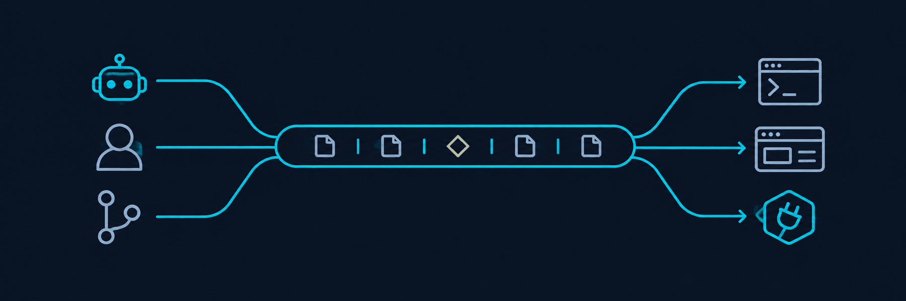
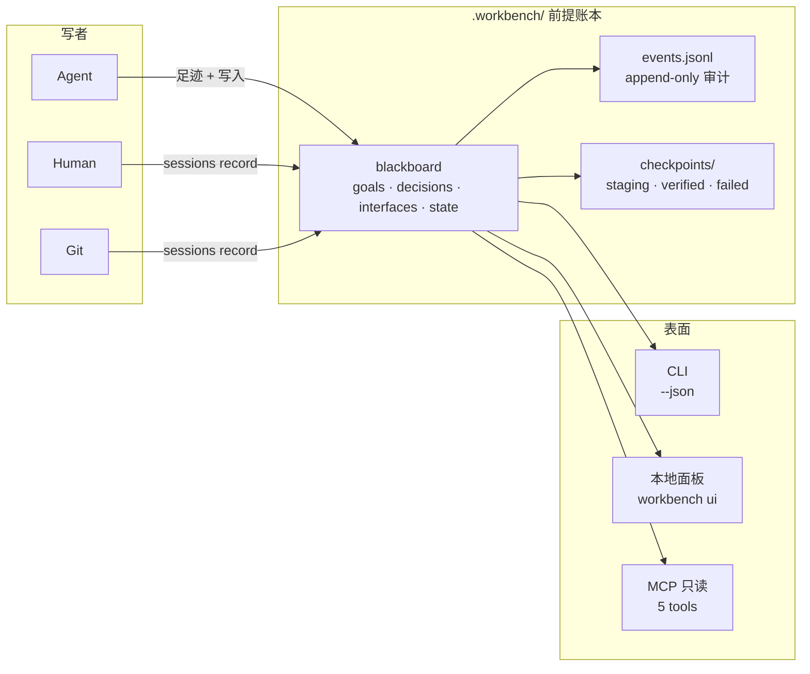
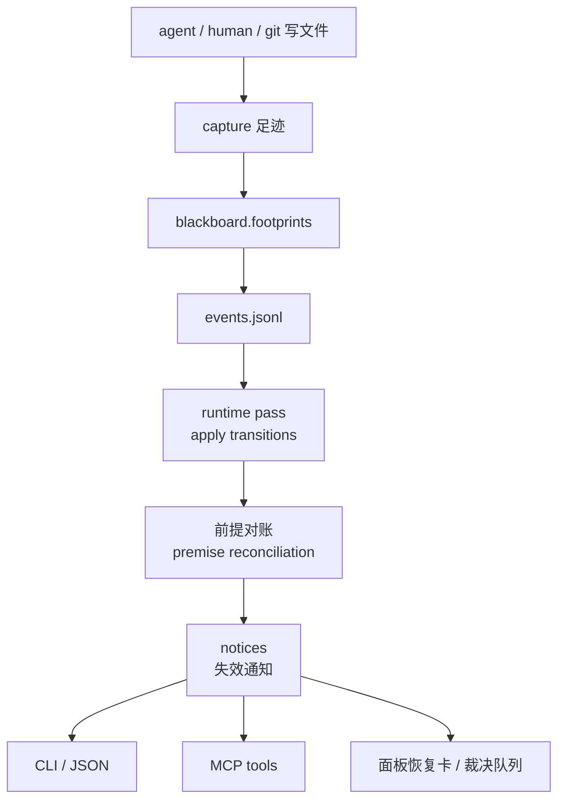
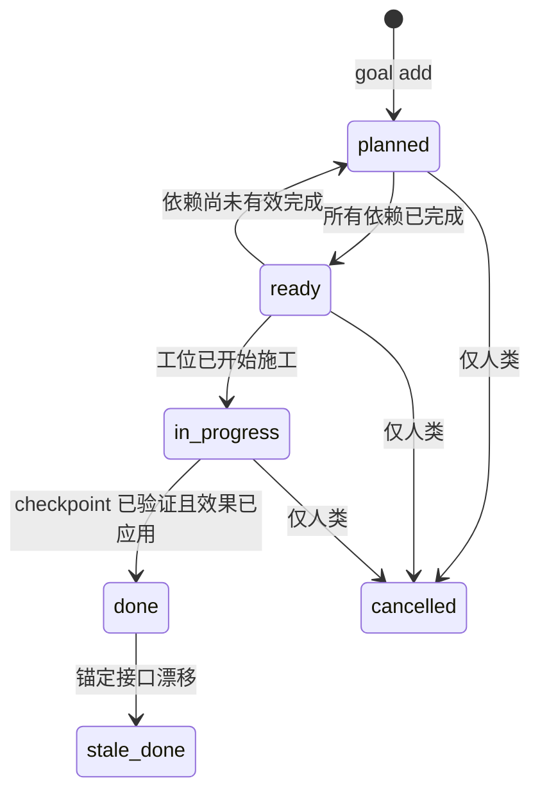
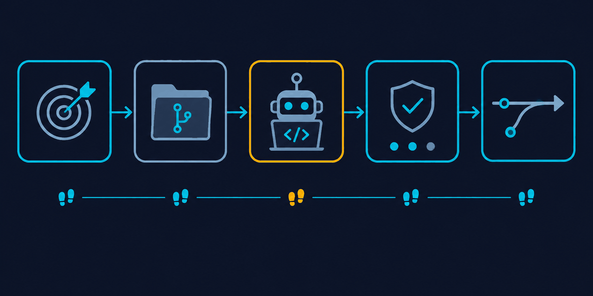
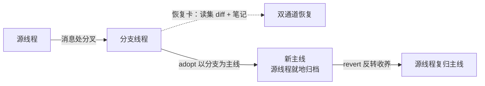

# VerseSpace / Workbench

<p align="center">
  
</p>

<p align="center">
  <a href="https://github.com/Baixu22/VerseSpace/releases"></a>
  <a href="LICENSE"></a>
  <a href="package.json"></a>
  
  
</p>

**Workbench 是本地优先、写者中立的前提账本。** 它记录 agent、人和 Git 读写过哪些文件，在已记录的前提失效时给出证据，帮助你恢复对话、检查分支和决定下一步。

状态保存在项目内的 `.workbench/`（YAML + JSONL），不依赖数据库或指定编辑器。CLI 与本地面板读取同一份账本；agent 通过 MCP 与 stdin 获取通知，人通过恢复卡查看变化，需要人工判断的事项进入裁决队列。

---

## 目录

- [现状与验证边界](#现状与验证边界2026-09-27)
- [它能做什么](#它能做什么)
- [它不保证什么](#它不保证什么)
- [核心概念](#核心概念)
- [数据流](#数据流)
- [快速开始](#快速开始)
- [命令速查](#命令速查)
- [本地面板与聊天](#本地面板与聊天)
- [MCP 只读通道](#mcp-只读通道)
- [与 Agent 协作](#与-agent-协作)
- [仓库结构](#仓库结构)
- [本地开发与门禁](#本地开发与门禁)
- [发行](#发行)
- [存量与历史](#存量与历史)
- [文档地图](#文档地图)
- [许可与归属](#许可与归属)

---

## 现状与验证边界（2026-09-27）

本仓库按**工程研究原型**收尾，不是已验收的产品。两类结论必须分开读：**工程门通过（本机可执行范围）** ／ **产品证据不足**（[ADR-0023](docs/decisions/0023-research-prototype-closeout.md)）。

| 维度 | 现状 |
| --- | --- |
| 工程门 | 本机手跑；`lint` / `typecheck` / 三套测试 / `doctor` / 上传面门禁的读数见[本轮交接记录](docs/handoff/2026-09-27-claim-hygiene-round.md) |
| 可复跑证据 | [`evidence/claims.json`](evidence/claims.json) 登记 **16 条**声明，读数在 `evidence/readings/`；`bun run check:claims` 校验「仪器没变、被测代码没变」，过期即报 stale |
| 产品证据 | **不足**：真人自然使用窗口（issue #32）、非 Windows 平台执行（本机不可达）、Codex 写保护闭环（issue #31）都还没有读数 |
| 发行 | 最新 Release 是 [`workbench-v0.4.0`](https://github.com/Baixu22/VerseSpace/releases)；树上版本 `0.4.1`（[CHANGELOG](packages/workbench/CHANGELOG.md)）**未打 tag、未发布** |
| 平台覆盖 | 只有 **windows-x64** 跑过完整测试套件；其余三个平台目前只有交叉编译产物 |
| CI | **没有 CI**（[ADR-0021](docs/decisions/0021-retire-all-ci-channels.md)）：GitHub Actions 与极狐 JihuLab 通道都已退役，PR 上不会出现任何状态检查，门禁一律本机手跑 |

> **读表须知**：工程门的绿灯只覆盖「本机能跑的仪器」；产品维度（生产率、真实用户、跨平台）没有被证明，也不要在引用本仓库时把它们说成已证明。

---

## 它能做什么

<p align="center">
  
</p>

- **前提账本**：记录 agent / 人 / git 对文件的读写足迹；前提失效时给出可追溯的证据与恢复信息（读集 diff、恢复笔记、分支动静）。
- **三种界面**：
  - **CLI** — 每个子命令都支持 `--json` / `--quiet`，机器可读是契约的一部分；
  - **本地面板** — `workbench ui` 起深色 Web 面板（目标 DAG、工位、checkpoint、聊天、裁决队列）；
  - **MCP 只读投影** — `premises` / `footprints` / `resume_cards` / `tribunal` / `notices` 五个工具。
- **编排原语**：目标 DAG、工位（git worktree）、三区 checkpoint、派发与 watch 循环、裁决队列。
- **封印（seal）拦截点**：写者落入已声明的只读区域、或撞上失效前提时拦截并留痕。Claude Code 走 PreToolUse hook；Codex 车道是**实验通道**。
- **聊天面板**：线性对话、消息处分叉、双通道恢复卡、以分支为主线（adopt / revert）、工具足迹可点击查看原始消息与事件。

---

## 它不保证什么

- **足迹覆盖有限，沉默不等于前提全部有效。** 没有结构化路径的读取不在后备解析范围内（[ADR-0023](docs/decisions/0023-research-prototype-closeout.md)）。
- **封印不是仓库级写保护。** Git 与裸编辑器绕过拦截点；对某个命令的负面观测不能泛化到整个 CLI 版本；Codex 通道可能不发审批、目标可能无法归因，封印故障时当前实现放行。
- **不宣称效率收益。** 原型结题不等于已证实生产率提升。
- **不宣称跨平台已验证。** 四平台二进制由一台 Windows 主机交叉编译；只有 windows-x64 跑过完整测试。
- **不宣称 npm 包已可用。** 对外承诺的形态是 Release 上的单文件二进制；`@baixu22/workbench` 尚未发布到公开 registry。

---

## 核心概念

| 概念 | 是什么 |
| --- | --- |
| **前提（premise）** | 某个写者曾读过某文件的这件事；文件后来被别人改了，这条前提就失效 |
| **足迹（footprint）** | agent 实际读 / 写过哪些文件的账本记录 |
| **写者（writer）** | agent、人、git——三者在账本上同等地位，谁写的都记 |
| **工位（workspot）** | 绑定 git worktree 的工作位；派发时生成 `.agent-context.md` |
| **checkpoint** | 阶段验收点，三区：`staging` / `verified` / `failed`；可声明验证策略 |
| **裁决（tribunal）** | 系统答不了、需要人类决策的事项队列 |
| **封印（seal）** | 写入前的拦截判定点（只读区域、失效前提） |
| **恢复卡（resume card）** | 线程离开期间发生了什么：读集 diff、恢复笔记、分支动静 |



---

## 数据流



**runtime 一轮做的事**（`workbench sync` / `workbench watch` 触发）：拿运行锁 → 应用状态机转移 → 对账前提 → 发事件 / 通知。单轮不递归，全程可审计。



> 目标状态集合见 `packages/workbench/src/types/goal.ts`（`planned` / `ready` / `in_progress` / `done` / `stale_done` / `cancelled`）。转移边与注释见 `packages/workbench/src/automaton/goal-machine.ts`：依赖只有 `done` 才算满足（`stale_done` / `cancelled` 会阻塞下游并弹出裁决信封）；`in_progress → done` 不仅要求 checkpoint 进 `verified/`，还要求其声明的 blackboard 效果已 `applied`；`cancelled` 与 `stale_done` 是终态，只有人类动作能救。

---

## 快速开始

从 [VerseSpace Releases](https://github.com/Baixu22/VerseSpace/releases) 下载对应平台的 `workbench-*` 单文件可执行程序，放入 PATH 并命名为 `workbench`（Windows 为 `workbench.exe`）。二进制内含运行时与面板，无需另装 Bun。

在要管理的项目目录中运行：

```bash
workbench init
workbench ui
```

`workbench ui` 启动本地面板，默认地址为 `http://127.0.0.1:7700`（`--port` 可换端口，`--no-open` 只起服务）。`workbench --json doctor` 检查账本一致性；只有 `severity: "error"` 的检查会让它非零退出。

**5 分钟编排一条目标：**

```bash
workbench goal add "实现 Blackboard 数据层" --acceptance "读写往返一致"
workbench decision add "所有写走原子 rename" --rationale "防止并发写损坏"
workbench interface register contracts/api.md --key core/api
workbench ws create ws-a --task <goal-id> --branch ws/ws-a
workbench dispatch <goal-id>
workbench checkpoint create --goal <goal-id> --workspot ws-a \
  --assertion "测试全绿" --strategy test
workbench sync
workbench watch   # 可选：后台监听
```

完整安装、配置、聊天与 MCP 用法见 [Workbench 使用说明](packages/workbench/README.md)。

---

## 命令速查

| 命令 | 作用 |
| --- | --- |
| `init` | 幂等初始化 `.workbench/` 目录 |
| `goal add/list/show/cancel` | 目标 DAG 管理 |
| `decision add` | 追加架构决策（append-only，修正靠新决策取代） |
| `interface register/list/check` | 接口注册表与 hash 漂移检查 |
| `ws create/list/reassign/status` | 工位（git worktree 绑定）管理 |
| `checkpoint create/list/restore/review` | 三区 checkpoint（staging / verified / failed） |
| `dispatch <goal> [ws]` | 派发就绪目标到空闲工位（真实 git worktree + 上下文生成） |
| `sync` | 手动跑一轮 Runtime 循环 |
| `watch` | 后台监听，文件变化自动跑循环 |
| `status` / `map` / `log` / `queue` | 状态概览 / DAG 文本图 / 事件流 / 执行队列 |
| `doctor` | 全量一致性体检（`severity: "error"` 才非零退出） |
| `config set <key> <value>` | 修改 `workbench.yaml` |
| `stats` | 分叉、恢复耗时、通知结局、地标认可率与样本不足情况 |
| `metrics` | 各车道用量：tokens / 缓存命中 / 压缩次数 |
| `wip` | Little's Law 推导的在制品 |
| `sessions list/show/record` | 写者记录；登记 git 或人的文件改动 |
| `premises pending` / `premises seal` / `premises review-seal` | 待投递前提失效；显式封印判定点；复核一次封印 |
| `context list/lower/review --writer <id>` | 查看上下文、降低过时条目兴趣、记录地标认可或拒绝 |
| `agent run` | 在工位内启动 agent 会话 |
| `tribunal list/show/shelve/resolve/stats` | 裁决队列（SBAR 卡片、搁置、结案、验收数） |
| `mcp` | 启动只读 MCP 服务器（stdio） |
| `ui` | 启动本地面板 |

所有命令支持 `--json`（机器可读）与 `--quiet`。

---

## 本地面板与聊天

<p align="center">
  
</p>

```bash
workbench ui            # 打开 http://127.0.0.1:7700（自动开浏览器）
workbench ui --no-open  # 只启动服务，适合自动验证与无界面环境
workbench ui --port 8080 --ui-dir ./some-dist
```

面板覆盖：目标 DAG、工位与派发、checkpoint 三区、接口漂移、决策与事件流、doctor 体检、聊天线程、裁决队列（composer 上方可直接 resolve / shelve）。

### 聊天通道的观测与保护边界

| 车道 | provider | 读集（agent 读了哪些文件） | 前提失效时 |
| --- | --- | --- | --- |
| 工具车道 | `claude`（本机 Claude Code） | **可观测**：工具调用留下足迹，可追溯到具体文件 | 能定位受影响的消息，并给出证据 |
| 实验工具车道 | `codex` | 部分可观测：结构化路径与有限 cat 后备解析；无路径的 Get-Content 不被捕获 | 可归因写审批会咨询 seal；缺足迹、无审批或无法归因时不受保护，**真实写保护未验证** |
| 纯文本车道 | `openai-chat` / `openai-responses` / `anthropic` | **不可观测**：没有工具通道，读过什么无从得知 | 只能标注「读集不可观测、不参与继承」，不给证据 |

选择建议：要让前提链成立（读集继承、失效定位、分叉时的读集来源），用 `claude`；只做对话、不在意前提链，HTTP 车道可用且不需要本机 Claude 登录。面板线程头按**每一轮实际使用的 provider** 标注可观测性。

Claude 车道在 spawn 时挂上 Workbench 的**只读账本 MCP**，模型在回合中可自查前提与足迹；折入 prompt 的前提通知会作为消息 part 持久化。

### 分叉、恢复与「以分支为主线」



- **分叉**：在消息处开支线；读集可继承（前提链完整时）。
- **恢复卡**：线程离开期间的读集 diff、恢复笔记、分支动静。
- **adopt / revert**：`POST /api/chat/threads/:id/adopt` 把分支升为主线、源线程归档；`revert` 用收养时的身份快照瞬时反转（只记指针不记内容）。双方消息一字不改、不合并。事件落审计（`thread.adopted` / `thread.adoption_reverted`）。

### 聊天配置

HTTP provider 可从 `WORKBENCH_CHAT_API_KEY` 环境变量读取密钥，不必写入 `.workbench/workbench.yaml`。已保存的 `chat.apiKey` 优先。聊天配置与面板状态 API 都只返回 `hasKey`，不返回密钥。

---

## MCP 只读通道

`workbench mcp` 在 stdio 上以 MCP 协议暴露**五条只读工具**（JSON-RPC 2.0，零 SDK 依赖）。工具只读账本，不暴露编排动作；每个响应默认截断到 ≤2000 字符。

| 工具 | 回答的问题 |
| --- | --- |
| `premises` | 哪些写者读过的文件已被其他写者修改（待投递的前提失效通知） |
| `footprints` | agent 实际读 / 写了哪些文件（足迹账本） |
| `resume_cards` | 线程在离开期间发生了什么（读集 diff、恢复笔记、分支动静） |
| `tribunal` | 裁决队列里有什么在等人类决策 |
| `notices` | 通知投递情况（已投递 / 待投递） |

**Claude Code** — 在项目根 `.mcp.json` 添加：

```json
{
  "mcpServers": {
    "workbench": {
      "command": "workbench",
      "args": ["mcp"]
    }
  }
}
```

源码形态可把 `command` 换成 `bun`、`args` 用 `["packages/workbench/src/index.ts", "mcp"]`。也可 `claude mcp add workbench -- workbench mcp` 注册到用户级。

**Cursor** — Settings → MCP → Add global MCP server，或使用项目 `.cursor/mcp.json`（形状同上）。

---

## 与 Agent 协作

派发时 Workbench 在工位 worktree 内生成 `.agent-context.md`（按工位声明的 `contextNeeds` 组装任务、验收条件、相关决策与接口）。让 Agent 阅读该文件即可——不侵入任何 Agent，利用已有的项目指令机制。

调度策略由 `workbench.yaml` 控制：

| 策略 | 行为 |
| --- | --- |
| `manual`（默认） | 人工派发 |
| `semi-auto` | 提示建议 |
| `auto` | 自动填充空闲工位（受并发上限约束） |

`.workbench/workbench.yaml` 的选项是**被执行的**，不是装饰：`protection.readonlyAreas` 经封印点拒写；`thresholds.checkpointTimeout` / `thresholds.idleNotification` 生效；`protection.gitHook` / `config.project` 由 `doctor` 断言。

### `.workbench/` 目录结构

```
.workbench/
├── workbench.yaml            # 配置（调度策略、保护规则、阈值）
├── blackboard/               # 唯一数据层（所有模块经它读写）
│   ├── goals/*.yaml          # 目标（状态机 + 依赖 + 接口锚定）
│   ├── decisions/*.yaml      # 架构决策（append-only）
│   ├── interfaces/registry.yaml
│   └── state/                # 工位、执行队列、已知冲突
├── checkpoints/              # staging / verified / failed 三区
└── events/events.jsonl       # 追加式事件审计日志
```

---

## 仓库结构

| 路径 | 内容 |
| --- | --- |
| [packages/workbench](packages/workbench) | CLI、前提账本、调度、聊天车道与本地 HTTP 服务（`@baixu22/workbench`，v0.4.1） |
| [apps/workbench-ui](apps/workbench-ui) | React 19 + Vite + Tailwind v4 本地面板，构建后嵌入 Workbench |
| [packages/context-rot](packages/context-rot) | 独立的指引引用检查器，也是 Workbench doctor 的扫描器 |
| [evidence](evidence) | 声明账本（`claims.json`，16 条）与可复跑读数；原始日志按 [ADR-0020](docs/decisions/0020-relay-handoff-upload-surface.md) 留本机 |
| [docs/handoff](docs/handoff) | 每轮交接记录：改了什么、实测读数、刻意没做什么 |
| [docs/decisions](docs/decisions) | ADR：一条决策一个文件、只增不改（0001–0023） |
| [docs/assets](docs/assets) | README / 文档插图 |

**`packages/workbench` 主要模块**（细节见 [AGENTS.md](AGENTS.md)）：

| 模块 | 职责 |
| --- | --- |
| `blackboard/` | 唯一数据层：目标、决策、接口注册表、状态、checkpoint、事件 |
| `automaton/` | 目标 / 工位 / checkpoint 状态机 + evaluator |
| `runtime/` | 一轮运行：锁、转移、前提对账、事件 |
| `scheduler/` | 派发、合并守卫、分支占用、WIP、通知、tick |
| `verifier/` | 执行 checkpoint 验证策略（`test` / `type-check` / `build` / `human-review`），结果分类为 passed / failed / needs_human / timeout / skipped |
| `supervisor/` | 进程监督：spawn、存活性、崩溃环、孤儿回收 |
| `chat/` | `claude` / `codex`（可观测工具车道）+ 三个 HTTP 纯文本车道；流式、渲染状态、线程、分支收养 |
| `agents/` | 启动 agent 会话、捕获工具足迹、记录用量 |
| `interactions/` | 兴趣 / 上下文推导、地标投影、复核队列（DOI） |
| `tribunal/` | 人类决策队列：kind、升级、合理化、envelope |
| `contextgen/` | 生成工位 `.agent-context.md` |
| `doctor/` | 全账本一致性检查；`interface_drift` 为 error |
| `mcp/` | stdio MCP 只读服务器（5 tools） |
| `ui/` | 面板 HTTP 服务、聊天 / 工作区 / 裁决路由、内嵌资源 |
| `watcher/` | chokidar 监听 → 触发 runtime pass |
| `git/` | 不抛异常的 git 运行器（worktree、merge-tree、refs） |
| `fs/` | 原子写 / rename、运行锁 |

---

## 本地开发与门禁

使用仓库固定的 **Bun 1.3.14**（`package.json` 的 `packageManager`），在根目录运行：

```bash
bun install --frozen-lockfile
bun run typecheck
bun run lint
bun run test        # workbench → workbench-ui → context-rot 三套
bun run dev:ui      # 面板开发服务器，API 代理到本地 workbench ui
```

提交前按仓库自己的门禁清单手跑（**没有任何自动化会替你跑**）：

```bash
bun run lint && bun run typecheck
bun run test:workbench && bun run test:workbench-ui && bun run test:context-rot
bun packages/workbench/src/index.ts doctor
bun run check:upload-surface --strict-references
bun run check:claims
pwsh -NoProfile -File scripts/win/e2e-browser.ps1   # 真实浏览器套件（隔离工作区）
```

构建并验证本机发行物：

```bash
cd packages/workbench
bun run build
bun run test:build
```

`build` 会构建面板，产出本机二进制与需要 Bun 的 JS 包，并复制归属和许可文件；`test:build` 在独立工作区验证两种产物的 CLI、扫描器与内嵌面板。四平台交叉编译：`bun run build:all`。

**上传面**（[ADR-0020](docs/decisions/0020-relay-handoff-upload-surface.md)）：只有换机可复算的结果性产物入库（源码、测试、ADR、交接记录、README 插图）；原始日志、探针 dump、E2E 现场、密钥、构建产物留本机。`check:upload-surface` 是**双向**门禁——漏传该传的、传了该留的都会失败；退出码 **2** 表示「量不了」，**绝不是通过**。

工程约定（代码组织、命令契约、图标与字号规则）见 [AGENTS.md](AGENTS.md)；贡献流程与 Windows 本机注意事项（注入式代理、子进程限制、Git 主机缺陷）见 [CONTRIBUTING.md](CONTRIBUTING.md)。

---

## 发行

发行是**真实发布动作**，三步且顺序不能换——tag 必须先到 `origin`，因为发布脚本带 `--verify-tag`：

```bash
bun run release:tag:workbench --push
cd packages/workbench && bun run build:all
node scripts/publish-workbench-release.mjs --tag workbench-v<version>
```

1. 确认 `packages/workbench` 的 version 与 [CHANGELOG](packages/workbench/CHANGELOG.md)（**没有 `.changeset/`**——版本与变更日志手写）。
2. `bun run release:tag:workbench --push`（默认 dry-run；`--push` 是真实发布）。
3. `cd packages/workbench && bun run build:all`，再 `node scripts/publish-workbench-release.mjs --tag workbench-v<version>`——挂上四平台二进制 + `SHA256SUMS` + 许可/归属文件，并在说明里写明**只有 windows-x64 跑过测试套件**。

发行说明里**必须保留平台覆盖声明**。是否切 `0.4.1` 由维护者决定（issue #33），本节只描述确定下来的动作。npm 形态**尚未发布**，不是待办清单上的「下一步」，而是维护者明确暂缓的决定（详见 [packages/workbench/README](packages/workbench/README.md)）。

---

## 存量与历史

旧 Helmor 桌面实现已退役：`src/`、`src-tauri/`、`sidecar/` 与外围应用不在当前工作树中，历史代码与旧产品介绍可在提交 `944b9d6` 及更早版本查阅。退役条件、执行与收口分别见 [ADR-0014](docs/decisions/0014-legacy-retirement-gate.md)、[ADR-0015](docs/decisions/0015-legacy-retirement-execution.md)、[ADR-0016](docs/decisions/0016-retirement-closeout.md)。

**不要**重新引入 Tauri、Rust/`cargo` 或 sidecar 进程进主线。若某任务看起来需要它们，先说明，而不是直接加回。

---

## 文档地图

| 文档 | 内容 |
| --- | --- |
| [packages/workbench/README.md](packages/workbench/README.md) | 安装、命令全集、聊天车道、MCP、live E2E、发行细节 |
| [AGENTS.md](AGENTS.md) | 架构总览、模块表、代码组织规则、本机环境坑 |
| [CONTRIBUTING.md](CONTRIBUTING.md) | 贡献流程、门禁清单、Windows 注意事项 |
| [SECURITY.md](SECURITY.md) | 安全边界与报告渠道 |
| [docs/decisions/](docs/decisions/README.md) | ADR 0001–0023（先读这些再提架构改动） |
| [docs/handoff/](docs/handoff/README.md) | 每轮交接：改了什么、实测读数、刻意没做什么 |
| [evidence/claims.json](evidence/claims.json) | 16 条可复跑声明与失效规则 |
| [packages/workbench/CHANGELOG.md](packages/workbench/CHANGELOG.md) | 发行变更（0.1.0 → 0.4.1） |
| [docs/user/](docs/user/README.md) | **旧 Helmor 用户指南，已退役，仅作记录** |

---

## 许可与归属

Workbench 包为 **MIT，含 Apache-2.0 部分**（SPDX：`MIT AND Apache-2.0`）。具体范围见 [包 NOTICE](packages/workbench/NOTICE)、[MIT 许可](packages/workbench/LICENSE) 和 [Apache-2.0 许可](packages/workbench/LICENSE-APACHE)。根目录的 [LICENSE](LICENSE) 与 [NOTICE](NOTICE) 保留上游许可、版权和商标归属。

Apache-2.0 §4(d) 要求分发时附上可读的 NOTICE——构建与发行脚本会把 `NOTICE` / `LICENSE` / `LICENSE-APACHE` 一并带上，请不要删除。

**“Helmor”及其 logo 是 Caspian Zhao 与 Nathan Lian 的商标。** Apache-2.0 授权源码的使用、修改与再分发，但**不授权**用该名称或 logo 标识本产品或派生品——本产品使用独立名称 VerseSpace / Workbench，包名为 `@baixu22/workbench`。

安全边界与报告渠道见 [SECURITY.md](SECURITY.md)；问题反馈请提交到 [VerseSpace Issues](https://github.com/Baixu22/VerseSpace/issues)。
