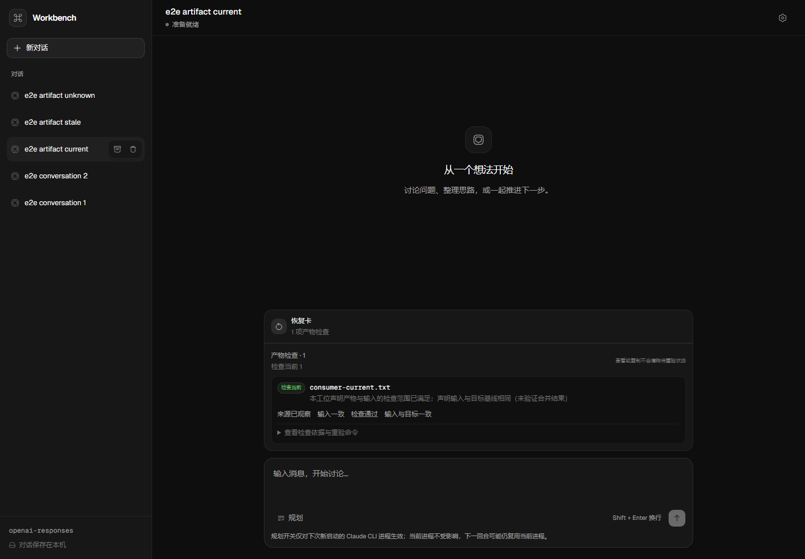
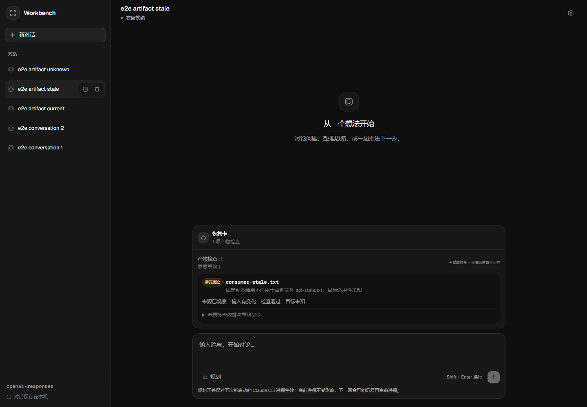
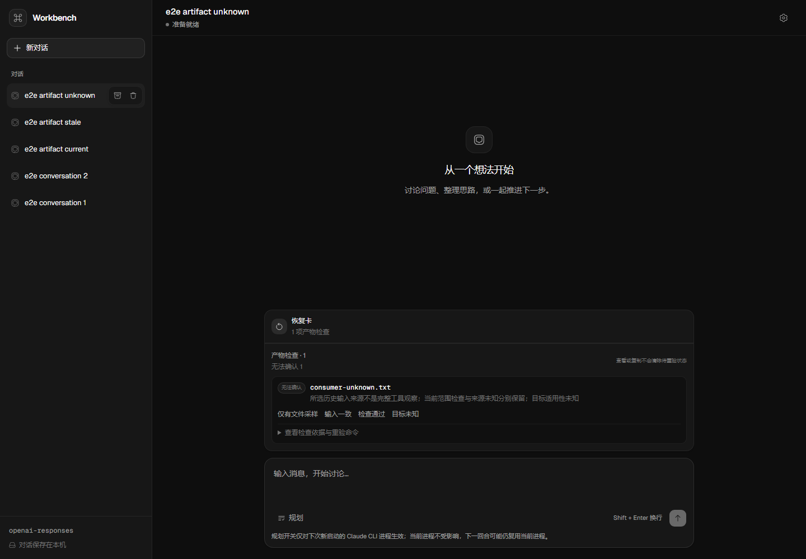

# TF-0310：恢复卡中的产物来源、范围、目标与重验入口

现有恢复卡现在直接消费线程 GET 已经返回的 `artifactReviews` shared projection；没有新增
API、写端点或第二套状态计算。新字段覆盖 current / stale / pending / failed / unknown
五种状态，并在主层面分别显示来源强度、输入匹配、最近检查与目标结论。弱来源、历史
检查通过和目标未知会同时保留，避免把“若干字段通过”渲染成整体可用。

每条产物只在折叠区暴露检查依据、输入摘要、目标 commit 与既有
`workbench checkpoint revalidate <checkpoint>` 命令。复制按钮只调用浏览器 clipboard，
不执行命令、不调用恢复消费接口，也不改 store 或账本。空或截断投影保留总量、五状态
计数和 omitted 数；超过现有展示上限时给出 `checkpoint list --artifact-view` 入口。

## 实际浏览器场景

`scripts/win/e2e-browser.ps1` 现在在隔离 workspace 中创建五个真实会话，并通过真实
Blackboard、Git、固定文件 Verifier 建立：

- `current`：工具观察输入、固定副本检查通过、输入与目标基线一致；
- `stale`：检查后把当前输入改为 v2，固定副本结果不能继续授权；
- `unknown`：历史读取只有文件采样，当前文件一致但来源强度不足，整体保持 unknown。

浏览器测试逐项比对画面和 shared projection。unknown 状态特意同时显示“仅有文件
采样”“输入一致”“检查通过”“目标未知”，证明来源、输入、历史检查与目标没有互相
冒充。复制 stale 命令后重新 GET 线程，`artifactReviews` 与复制前逐字段相同，待重验
没有因查看或复制被清除。

三张成功截图是受控隔离数据的真实 Chromium 画面，不是 store 注入或概念图：







场景 ID 为 `artifact-review`，受测源码是提交前工作树；视口 1440×1000、全页截图，
主题跟随本机深色设置。PNG 尺寸与 SHA256：

| 状态 | bytes | SHA256 |
| --- | ---: | --- |
| current | 58,686 | `307e585637b69c46a65ead83adf82939b4723943afb0bb14955635cd60fffa23` |
| stale | 60,288 | `a4ec272fb186a647f526b18691cec36cb7e758aa19e06f10f42dcc6a2456e632` |
| unknown | 59,440 | `ca984e98cedfa1a24eb72cce972e22bd2e316eb11668371c41ba55630d6aeda5` |

## 门禁读数

- 目标 Vitest（新产物卡、既有恢复卡交互、恢复耗时观测）：17 pass / 0 fail，3 文件。
- 完整 dashboard：75 pass / 0 fail，20 文件，exit 0。
- Windows 真实浏览器：15 pass / 0 fail，含新增产物卡场景；Playwright exit 0。
- 三包 typecheck 通过；新增/修改 TS/TSX 通过 Biome。
- ego-lite 独立复核三状态 DOM、命令与横向溢出，三次均通过并正常结束任务空间；
  ego-lite 自身 `Page.captureScreenshot` 在本机 Chromium 连续超时，因此不把 ego 截图
  算作证据，成品截图来自同一真实链路的 Playwright 成功截图。该超时记录在本地
  `evidence/raw/tf0310-ego-review.json`。

这是单产物、单线程的界面验收，不证明 100 个工位容量、真实模型收益、自然用户效率
或市场效果。MCP 仍只有五个只读工具，CLI 仍是唯一的实际重验执行入口。

## 复核

```bash
bun run test:workbench-ui
pwsh -NoProfile -File scripts/win/e2e-browser.ps1
```